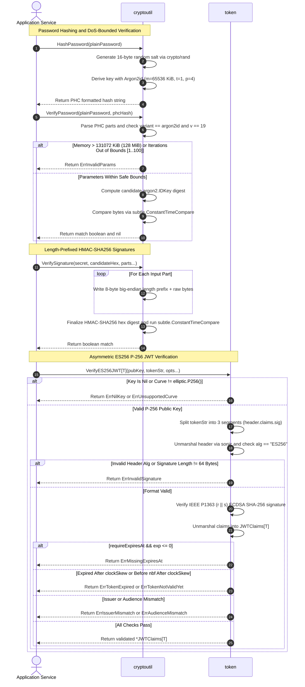
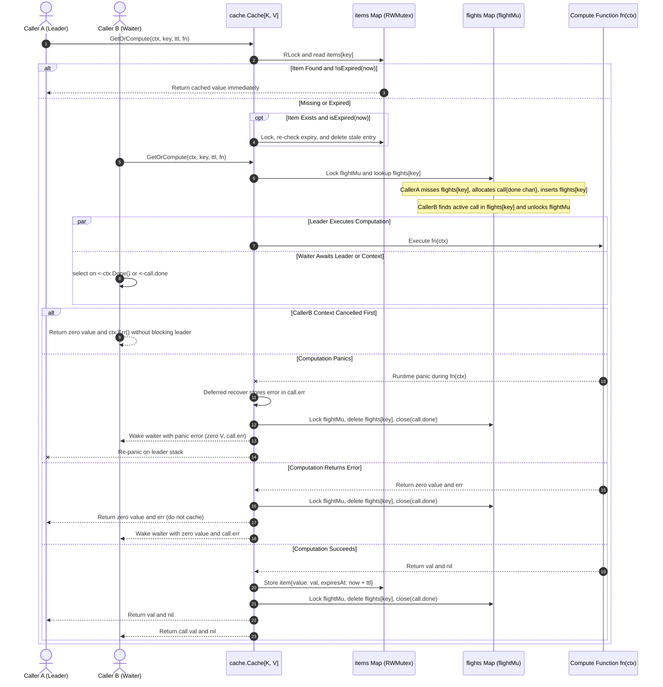
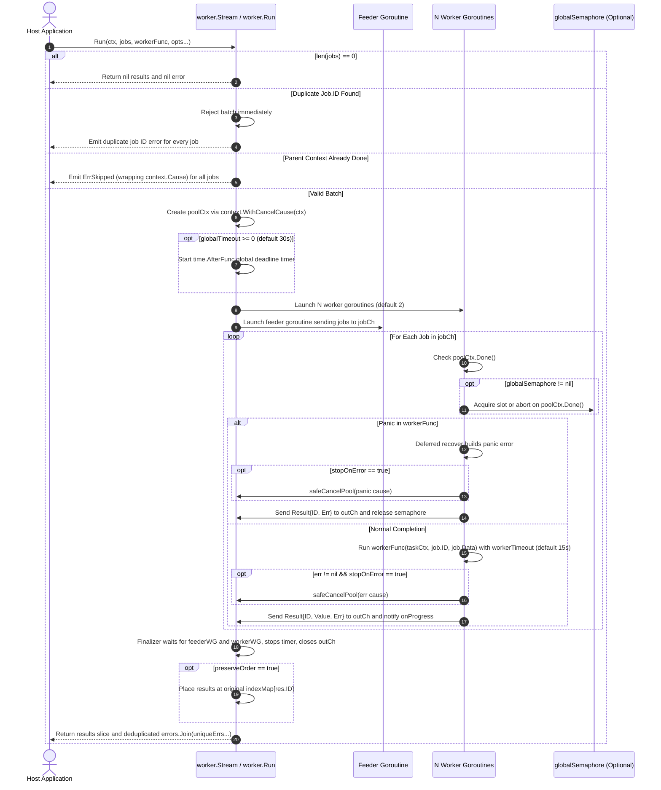
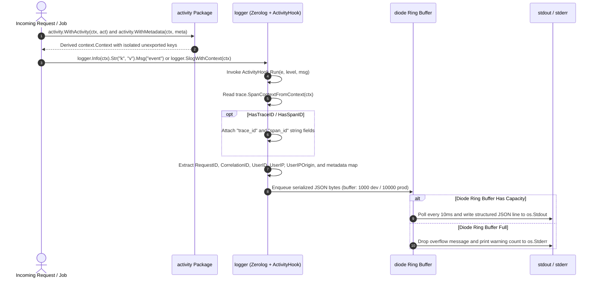
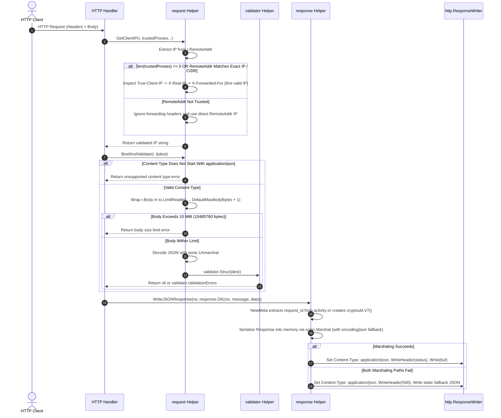
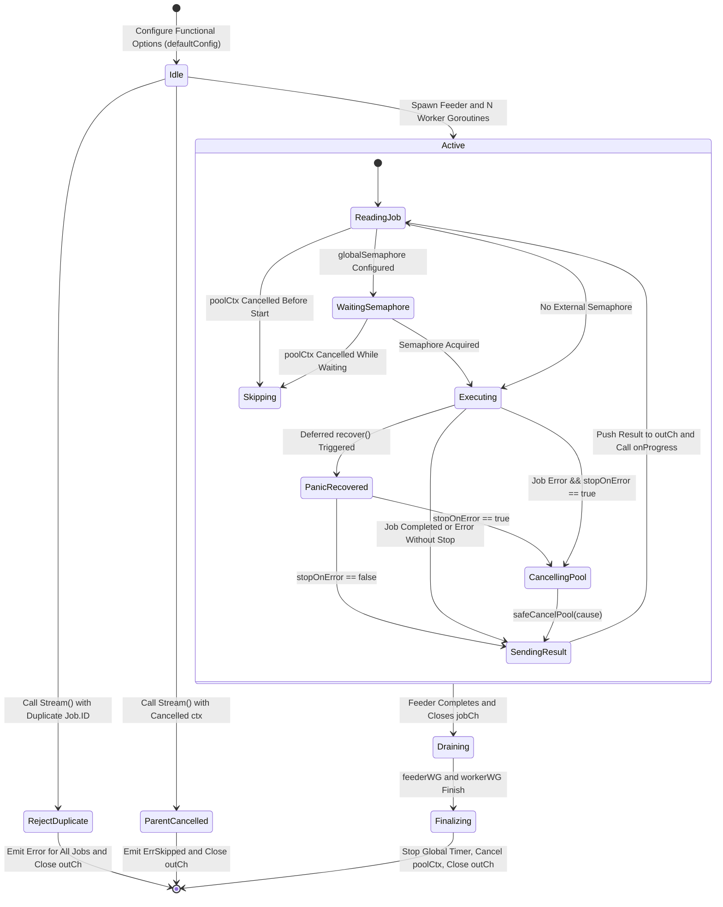
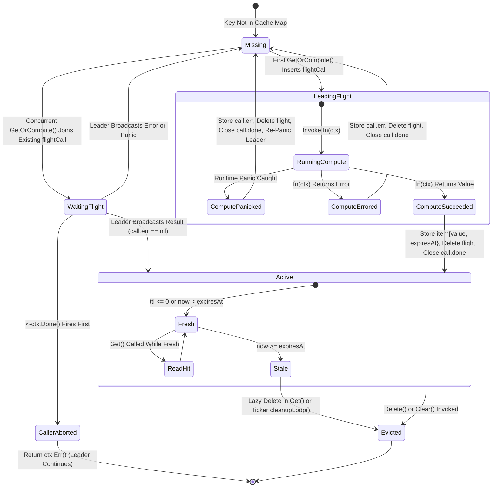
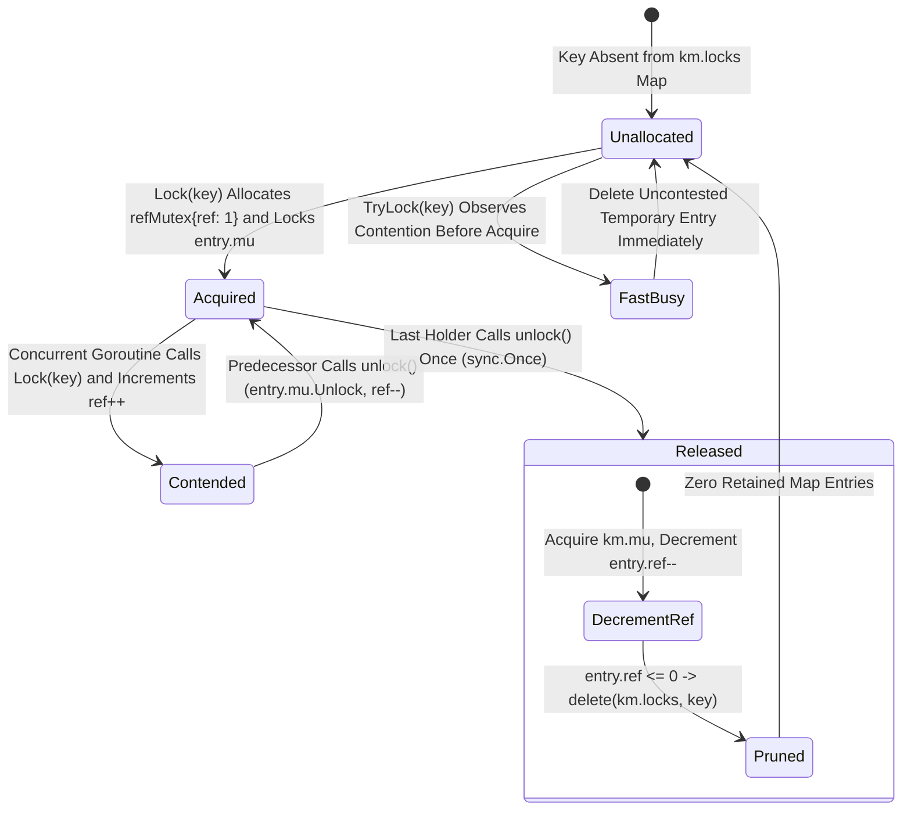
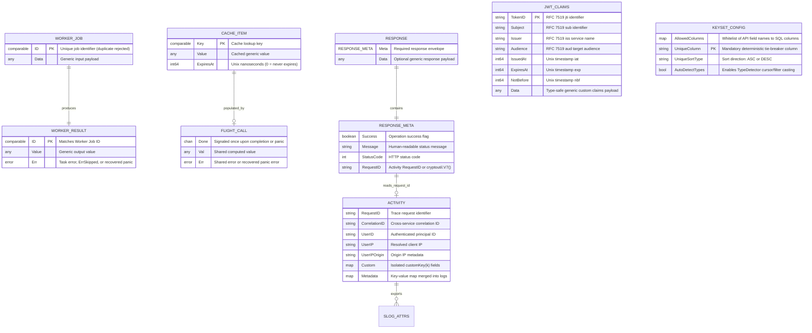

# NVX Go Helper Technical Documentation

[](go.mod)
[](LICENSE)

---

## 1. System Overview

The `github.com/Jkenyut/nvx-go-helper` module supplies 17 independent Go utility packages (`go 1.27.3`) for backend microservices and HTTP APIs.

- **Standard-Library-First Architecture**: Implements concurrency, time formatting, MIME detection, cryptography, and HTTP helpers directly on the Go standard library (`net/http`, `crypto/*`, `slices`, `maps`, `sync`, `log/slog`).
- **Compile-Time Type Safety**: Uses Go generics across `cache.Cache[K, V]`, `worker.Job[K, T]` / `worker.Result[K, R]`, `syncutil.KeyedMutex[K]`, `token.JWTClaims[T]`, `retry.DoWithResult[T]`, `maputil`, `sliceutil`, and `pagination`.
- **Direct Third-Party Dependencies** (`go.mod`):
  - `github.com/bytedance/sonic v1.15.5` — High-throughput JSON encoding and decoding in `logger`, `request`, `response`, `token`, and `cryptoutil`.
  - `github.com/go-playground/validator/v10 v10.30.6` — Struct validation and custom tag registration (`nik`, `npwp`, `phone_id`) in `validator`.
  - `github.com/google/uuid v1.6.0` — UUID v4, UUID v7, and path UUID validation in `cryptoutil` and `request`.
  - `github.com/rs/zerolog v1.35.1` — Non-blocking diode JSON logging and `slog.Handler` adapter in `logger`.
  - `go.opentelemetry.io/otel/trace v1.47.0` — OpenTelemetry `trace_id` and `span_id` extraction in `logger`.
  - `golang.org/x/crypto v0.59.0` — Argon2id key derivation (`golang.org/x/crypto/argon2`) in `cryptoutil`.
  - `github.com/stretchr/testify v1.12.1` — Unit test assertions across package test suites.

---

## 2. System Architecture

The library organizes all 17 packages across explicit architectural boundaries inside the host Go service. Because `nvx-go-helper` is a stateless utility module, the repository contains no SQL migration engine, no database driver connections, and no standalone HTTP router.

```mermaid
flowchart TD
    subgraph HostRuntime ["Host Go Microservice"]
        HTTPInbound["HTTP Handlers and Middleware"]
        DomainLogic["Application Use Cases and Workers"]
    end

    subgraph InboundAdapter ["Inbound Adapter"]
        REQ["request (JSON Body Limit, Query, Path, Trusted Proxy IP)"]
        RESP["response (Pre-Buffered JSON Envelope Writer)"]
        PAG["pagination (Offset, Dynamic Keyset SQL, Cursor Normalization)"]
        VAL["validator (v10 Engine, nik/npwp/phone_id Tags)"]
    end

    subgraph ApplicationCore ["Application and Core Domain"]
        WRK["worker (Bounded Worker Pool and Result Stream)"]
        SYNC["syncutil (Ref-Counted KeyedMutex)"]
        RTR["retry (Exponential Backoff, Jitter, Timer Cleanup)"]
        CRYPTO["cryptoutil (Argon2id, AES-GCM, ECIES, RSA, HMAC, UUID)"]
        TKN["token (ES256 P-256 JWT Sign and Verify)"]
        FILE["fileutil (MIME Magic Check, Path Sanitizer)"]
        FMT["format (UTC/WIB Time, Rupiah/Dollar, Log Masking)"]
        MAPU["maputil (Generic Map Transformations)"]
        SLC["sliceutil (Generic Slice Transformations)"]
    end

    subgraph InfraPersistence ["Infrastructure and State (Stateless — No SQL Layer)"]
        CCH["cache (In-Memory TTL Map and Singleflight)"]
        ENV["env (Typed OS Environment Readers)"]
    end

    subgraph TelemetryObs ["Telemetry and Observability"]
        ACT["activity (Context Request, User, and Trace Metadata)"]
        LOG["logger (Zerolog Diode Ring-Buffer and slog Bridge)"]
    end

    subgraph ExternalDeps ["External Dependencies"]
        SONIC["bytedance/sonic v1.15.5"]
        ZLOG["rs/zerolog v1.35.1"]
        V10["go-playground/validator/v10 v10.30.6"]
        UUID["google/uuid v1.6.0"]
        OTEL["go.opentelemetry.io/otel/trace v1.47.0"]
        XCRYPTO["golang.org/x/crypto v0.59.0"]
    end

    HTTPInbound --> REQ
    HTTPInbound --> RESP
    HTTPInbound --> PAG
    HTTPInbound --> VAL
    HTTPInbound --> ACT

    DomainLogic --> WRK
    DomainLogic --> SYNC
    DomainLogic --> RTR
    DomainLogic --> CCH
    DomainLogic --> CRYPTO
    DomainLogic --> TKN
    DomainLogic --> FILE
    DomainLogic --> FMT
    DomainLogic --> MAPU
    DomainLogic --> SLC
    DomainLogic --> ENV

    REQ --> VAL
    REQ --> SONIC
    REQ --> UUID
    RESP --> SONIC
    RESP --> ACT
    RESP --> CRYPTO
    PAG --> SLC
    TKN --> SONIC
    CRYPTO --> SONIC
    CRYPTO --> UUID
    CRYPTO --> XCRYPTO
    VAL --> V10
    LOG --> ZLOG
    LOG --> OTEL
    LOG --> ACT
    LOG --> SONIC
```



---

## 3. Core Workflows

### 3.1 Auth, Password Hashing, and ES256 JWT Verification

`cryptoutil` enforces RFC 9106 Argon2id defaults, bounds memory decoding to prevent DoS attacks, computes length-prefixed HMAC signatures, and validates elliptic curves for ES256 JWTs in `token`.



### 3.2 In-Memory Cache and Singleflight Stampede Protection

`cache.Cache[K, V]` serves hot reads under `sync.RWMutex`, lazily deletes stale keys on expiry, collapses concurrent misses per key onto one leader flight, and safely handles context cancellation and worker panics.



### 3.3 Concurrent Worker Pool Execution

`worker.Stream` and `worker.Run` reject duplicate job IDs up front, enforce bounded worker concurrency and optional shared semaphores, isolate panics per job, and drain channels deterministically without leaking goroutines.



### 3.4 Distributed Tracing and Structured Logging Pipeline

`activity` carries request and user identifiers inside `context.Context`, while `logger.ActivityHook` automatically copies OpenTelemetry `trace_id`/`span_id`, activity fields, and custom metadata maps into non-blocking Zerolog JSON events and `log/slog` adapters.



### 3.5 HTTP Inbound Binding and Pre-Buffered JSON Response Pipeline

`request` validates proxy trust (exact IP or CIDR) before reading forwarding headers, checks `Content-Type` and body size bounds before decoding JSON with Sonic, and `response` serializes full JSON payloads into memory prior to writing HTTP status codes.



---

## 4. Lifecycle and State Machines

### 4.1 Worker Pool and Job Execution Lifecycle



### 4.2 In-Memory Cache Item and Singleflight Lifecycle



### 4.3 Per-Key Reference-Counted Mutex Lifecycle (`syncutil.KeyedMutex[K]`)



---

## 5. Data Models and Schema

**Database Schema (`migrations/`): Not applicable.** This repository is a stateless Go library module and stores zero database migrations, SQL DDL tables, or persistent storage schemas.

The `erDiagram` below documents the core in-memory domain structs and SQL query configuration types defined across packages in this repository:



---

## 6. Deep Engineering and Concurrency Trade-Offs

### 6.1 Context-Aware Singleflight and Panic-Safe Broadcast ([cache/cache.go](cache/cache.go#L172-L211))

- **Problem**: Blocking a waiter unconditionally inside a shared computation stalls HTTP handlers past request deadlines, while an unrecovered panic in the leader leaves `call.done` open forever and deadlocks all waiting goroutines.
- **Decision**: `Cache.GetOrCompute` decouples cache data locking (`mu`) from in-flight tracking (`flightMu`), lets waiters `select` on either `<-ctx.Done()` or `<-call.done`, recovers panics into `call.err` before deleting the flight entry and closing `call.done`, and re-panics only on the leader stack.

```go
	c.flightMu.Lock()
	call, active := c.flights[key]
	if active {
		// An existing computation is already in flight for this key
		c.flightMu.Unlock()
		select {
		case <-ctxDone:
			var zero V
			return zero, ctx.Err()
		case <-call.done:
			if call.err != nil {
				var zero V
				return zero, call.err
			}
			return call.val, nil
		}
	}

	// First caller starts the in-flight job
	call = &flightCall[V]{done: make(chan struct{})}
	c.flights[key] = call
	c.flightMu.Unlock()

	var panicked bool
	var panicVal any

	defer func() {
		if r := recover(); r != nil {
			panicked = true
			panicVal = r
			call.err = fmt.Errorf("cache: computation panicked: %v", r)
		}
		c.flightMu.Lock()
		delete(c.flights, key)
		c.flightMu.Unlock()
		close(call.done)
		if panicked {
			panic(panicVal)
		}
	}()
```

### 6.2 Zero-Leak Per-Key Locking with Reference Counting ([syncutil/keyed_mutex.go](syncutil/keyed_mutex.go#L28-L62))

- **Problem**: Storing `map[K]*sync.Mutex` without eviction leaks memory linearly with unique entity IDs over time, while deleting an entry while another goroutine waits on its mutex splits mutual exclusion across two different `*sync.Mutex` instances.
- **Decision**: `KeyedMutex[K]` wraps each entry in `refMutex{mu, ref}` and updates `ref` exclusively under the outer `km.mu` lock; `Lock` acquires `entry.mu` only after releasing `km.mu`, returns an idempotent `sync.Once`-guarded `unlock` closure, and deletes the map entry only when `entry.ref <= 0`.

```go
func (km *KeyedMutex[K]) release(key K, entry *refMutex) {
	entry.mu.Unlock()

	km.mu.Lock()
	entry.ref--
	if entry.ref <= 0 {
		delete(km.locks, key)
	}
	km.mu.Unlock()
}

// Lock acquires the lock for key and returns an unlock function.
// Usage: defer km.Lock(key)()
func (km *KeyedMutex[K]) Lock(key K) func() {
	km.mu.Lock()
	if km.locks == nil {
		km.locks = make(map[K]*refMutex)
	}
	entry, exists := km.locks[key]
	if !exists {
		entry = &refMutex{}
		km.locks[key] = entry
	}
	entry.ref++
	km.mu.Unlock()

	entry.mu.Lock()

	var once sync.Once
	return func() {
		once.Do(func() {
			km.release(key, entry)
		})
	}
}
```

### 6.3 Composite Tuple Keyset SQL Generation Without OFFSET Scans ([pagination/cursor.go](pagination/cursor.go#L189-L223))

- **Problem**: Large SQL `OFFSET` pagination scans and discards preceding rows linearly with page depth, and naive tuple syntax `(a, b) > (?, ?)` prevents some SQL engines from utilizing composite B-Tree index prefix seeks across mixed `ASC`/`DESC` column directions.
- **Decision**: `BuildDynamicKeyset` expands multi-column cursors into index-friendly disjunctions `(col0 op0 ?) OR (col0 = ? AND col1 op1 ?)`, pre-allocates `finalArgs` (`n*(n+1)/2`) and `strings.Builder` capacity, and appends a mandatory tie-breaker `UniqueColumn` in `BuildKeysetQuery` so paging stays deterministic on duplicate sort keys.

```go
func BuildDynamicKeyset(columns []string, operators []string, values []any) (string, []any) {
	n := min(len(columns), len(operators), len(values))
	if n == 0 {
		return "", nil
	}

	if n == 1 {
		return "(" + columns[0] + " " + operators[0] + " ?)", []any{values[0]}
	}

	totalArgs := n * (n + 1) / 2
	finalArgs := make([]any, 0, totalArgs)

	var b strings.Builder
	b.Grow(n * 35)

	for i := 0; i < n; i++ {
		if i > 0 {
			b.WriteString(" OR ")
		}
		b.WriteByte('(')
		for j := 0; j < i; j++ {
			b.WriteString(columns[j])
			b.WriteString(" = ? AND ")
			finalArgs = append(finalArgs, values[j])
		}
		b.WriteString(columns[i])
		b.WriteByte(' ')
		b.WriteString(operators[i])
		b.WriteString(" ?)")
		finalArgs = append(finalArgs, values[i])
	}

	return b.String(), finalArgs
}
```

### 6.4 Argon2id Memory DoS Bounds and Length-Prefixed HMAC ([cryptoutil/argon2.go](cryptoutil/argon2.go#L190-L194), [cryptoutil/signature.go](cryptoutil/signature.go#L15-L29))

- **Problem**: Untrusted PHC strings with inflated `m=` parameters can trigger OOM allocation during `argon2.IDKey`, and naive concatenated HMAC inputs (`a + ":" + b`) allow delimiter-injection ambiguity across fields.
- **Decision**: `decodePHCHash` caps `Memory` at `maxMemoryKiB = 128 * 1024` (128 MiB) and `Iterations` at `[1, 100]` before allocating buffers; `Signature` frames every variadic part with an 8-byte big-endian length prefix before feeding SHA-256 HMAC.

```go
	// Sanity bounds check to protect against DoS / memory exhaustion (max 128 MiB)
	const maxMemoryKiB = 128 * 1024
	if p.Memory < 8 || p.Memory > maxMemoryKiB || p.Iterations < 1 || p.Iterations > 100 || p.Parallelism < 1 {
		return p, nil, nil, ErrInvalidParams
	}
```

```go
func Signature(secret string, data ...string) string {
	h := hmac.New(sha256.New, []byte(secret))
	lengthBuf := make([]byte, 8)

	for _, v := range data {
		binary.BigEndian.PutUint64(lengthBuf, uint64(len(v)))
		_, _ = h.Write(lengthBuf)
		_, _ = io.WriteString(h, v)
	}

	return hex.EncodeToString(h.Sum(nil))
}
```

### 6.5 Non-Blocking Diode Ring-Buffer Logging and Bounded Regex Cache ([logger/logger.go](logger/logger.go#L213-L215), [format/format.go](format/format.go#L464-L515))

- **Problem**: Synchronous stdout log writes block request goroutines under slow container log collectors, while dynamic keyword regex compilation inside log masking either burns CPU on every call or leaks heap memory if cached in an unbounded map.
- **Decision**: `logger.Init` wraps the output `io.Writer` in `diode.NewWriter` (polling every `10ms`) so workers never block when downstream I/O stalls, and `format.MaskAfterKeywords` caches compiled regexes in `maskRegexCache` (`sync.Map`) capped by `maxMaskRegexCacheSize = 256` tracked atomically.

```go
	wr := diode.NewWriter(writer, o.bufferSize, 10*time.Millisecond, func(missed int) {
		_, _ = fmt.Fprintf(os.Stderr, "[logger] warning: diode dropped %d log messages\n", missed)
	})
```

```go
const maxMaskRegexCacheSize = 256

var (
	maskRegexCache     sync.Map
	maskRegexCacheSize atomic.Int64
)
```

---

## 7. Source-Verified Reference Catalogs

### 7.1 Telemetry, Logging, and Observability Catalog

This module defines zero Prometheus or OpenTelemetry metric instruments (`Counter`, `Histogram`, or `Gauge`). Observability relies on OpenTelemetry span context extraction (`go.opentelemetry.io/otel/trace`), `activity` context attributes, asynchronous `zerolog/diode` JSON log emission, and a Go standard library `log/slog` bridge.

| Field / Signal Name | Instrument / Mechanism | Unit | Monitored Attributes / Scope | Description (ASD-STE100) |
| :--- | :--- | :--- | :--- | :--- |
| `trace_id` | JSON Log Field (`ActivityHook` / `slog`) | Hex string | `trace.SpanContextFromContext(ctx)` | Extracts active OpenTelemetry trace identifier when present in context. |
| `span_id` | JSON Log Field (`ActivityHook` / `slog`) | Hex string | `trace.SpanContextFromContext(ctx)` | Extracts active OpenTelemetry span identifier when present in context. |
| `request_id` | JSON Log Field (`ActivityHook` / `response`) | String (UUID v7 fallback) | `activity.WithRequestID` | Tracks per-request identifier across logs and response `Meta.RequestID`. |
| `correlation_id` | JSON Log Field (`ActivityHook`) | String | `activity.WithCorrelationID` | Propagates cross-service transaction identifier across context boundaries. |
| `user_id` | JSON Log Field (`ActivityHook`) | String | `activity.WithUserID` | Records authenticated user identifier in structured logs. |
| `user_ip` | JSON Log Field (`ActivityHook`) | IP string | `activity.WithUserIP` | Records resolved client IP address in structured logs. |
| `user_ip_origin` | JSON Log Field (`ActivityHook`) | String | `activity.WithUserIPOrigin` | Records raw or forwarding origin header metadata in structured logs. |
| `<metadata keys>` | JSON Log Fields (`ActivityHook`) | Arbitrary JSON | `activity.WithMetadata(ctx, map)` | Merges custom key-value map entries onto every log event from `ctx`. |
| `service`, `env`, `port` | Base Logger Fields (`logger.Init`) | String / Integer | `WithServiceName`, `WithEnv`, `WithPort` | Attaches service name, normalized environment, and optional port (`> 0`). |
| `[logger] warning: diode dropped %d log messages` | `os.Stderr` Callback (`diode.NewWriter`) | Message count | Global diode ring buffer | Alerts operator on `stderr` when log production exceeds ring-buffer capacity. |
| `Slog` / `SlogWithContext` | `*slog.Logger` Adapter (`zerologSlogHandler`) | Log record | `slog.Level`, attrs, groups | Bridges standard `log/slog` drivers into Zerolog with JSON and context hooks. |

### 7.2 HTTP Header and Gateway Contract

| Header Name | Required | Origin / Direction | Functional Role (ASD-STE100) |
| :--- | :--- | :--- | :--- |
| `Content-Type` | Yes (`BindJSON`) / Set (`WriteJSONResponse`) | Inbound Client / Outbound Server | `request.BindJSON` requires `application/json` prefix; `response.WriteJSONResponse` sets `application/json`. |
| `Authorization` | Conditional (`GetBearerToken`) | Inbound Gateway / Client | `request.GetBearerToken` parses case-insensitive `Bearer <token>` prefix and returns the token string. |
| `True-Client-IP` | No | Inbound CDN / Trusted Proxy | `request.GetClientIP` checks this header first when `RemoteAddr` matches `trustedProxies`. |
| `X-Real-IP` | No | Inbound Reverse Proxy | `request.GetClientIP` checks this header second when `True-Client-IP` is absent and proxy is trusted. |
| `X-Forwarded-For` | No | Inbound Load Balancer | `request.GetClientIP` extracts the first comma-separated IP when proxy is trusted and prior headers are empty. |
| Custom Header Name | No | Inbound Request / Outbound Response | `request.GetHeader(r, name)` performs canonical lookup; `response.SetHeaders(w, headers)` writes response headers. |

### 7.3 Configuration and Environment Matrix

This repository contains no `.env` or `config.template.yaml` files. Runtime configuration reads OS environment variables directly (or through typed helpers in [`env`](env/README.md)) and accepts Go structs (`logger.Config`) and functional options (`With*`).

| Environment Variable / Constant | Config Struct / YAML Path | Default Value | Description (ASD-STE100) |
| :--- | :--- | :--- | :--- |
| `LOG_LEVEL` | Overrides `logger.Config` (no YAML key) | `debug` (dev) / `info` (prod) | Overrides global Zerolog level when `WithLevel` option is unset. |
| `LOG_BUFFER_SIZE` | Overrides `logger.Config` (no YAML key) | `1000` (dev) / `10000` (prod) | Overrides diode ring-buffer capacity when parsed as positive integer. |
| `Config.NameService` (`logger`) | `name_service` (`json`/`yaml`) | `"unknown-service"` | Sets base `service` field attached to all structured log lines. |
| `Config.Env` (`logger`) | `env` (`json`/`yaml`) | `"development"` | Normalizes runtime mode (`production`/`prod` disables caller info and raises buffer). |
| `Config.Port` (`logger`) | `port` (`json`/`yaml`) | `0` (omitted if `<= 0`) | Attaches listening TCP port integer to structured log lines when positive. |
| Arbitrary Caller Keys (`env`) | Caller-defined keys via `os.Getenv` | Caller `fallback` (`MustGet` panics) | `env.GetString`, `GetInt`, `GetFloat64`, `GetBool`, `GetDuration`, `GetStringSlice`, `MustGet` read OS env vars. |
| `DefaultMaxBodyBytes` (`request`) | Constant | `10485760` (10 MiB) | Bounds `io.LimitReader` during `request.BindJSON` and `request.BindAndValidate`. |
| `DefaultParams` (`cryptoutil`) | `cryptoutil.Params` | `m=65536` (64 MiB), `t=1`, `p=4`, `salt=16`, `key=32` | Default RFC 9106 Argon2id parameters used by `cryptoutil.HashPassword`. |
| `LowResourceParams` (`cryptoutil`) | `cryptoutil.Params` | `m=19456` (19 MiB), `t=2`, `p=1`, `salt=16`, `key=32` | Reduced-memory Argon2id preset used by `cryptoutil.HashPasswordLow`. |
| `HighSecurityParams` (`cryptoutil`) | `cryptoutil.Params` | `m=65536` (64 MiB), `t=3`, `p=4`, `salt=16`, `key=32` | High-cost Argon2id preset used by `cryptoutil.HashPasswordHigh`. |
| `maxMemoryKiB` (`cryptoutil`) | Internal constant (`argon2.go`) | `131072` (128 MiB) | Rejects parsed PHC hashes exceeding 128 MiB or `Iterations` outside `[1..100]`. |
| `WithCleanupInterval` (`cache`) | `cache.Option` | `1m` (`<= 0` disables sweeper) | Configures ticker interval for background expired cache deletion. |
| `WithWorkers` (`worker`) | `worker.Option` | `2` | Sets concurrent worker goroutine count when `<= 0` or unset. |
| `WithWorkerTimeout` (`worker`) | `worker.Option` | `15s` (`< 0` disables; capped by global) | Sets per-job execution context deadline via `context.WithTimeoutCause`. |
| `WithGlobalTimeout` (`worker`) | `worker.Option` | `30s` (`< 0` disables) | Sets batch-wide pool deadline via `time.AfterFunc`. |
| `WithStopOnError` (`worker`) | `worker.Option` | `false` | Cancels `poolCtx` immediately when the first job returns an error or panics. |
| `WithPreserveOrder` (`worker`) | `worker.Option` | `false` | Orders `worker.Run` output slice to match input `jobs` indices. |
| `WithMaxAttempts` (`retry`) | `retry.Option` | `3` | Sets maximum execution attempts in `retry.Do` and `retry.DoWithResult`. |
| `WithDelay` / `WithBackoff` (`retry`) | `retry.Option` | `delay=0`, `multiplier=1.0` | Sets initial sleep duration and exponential multiplier (`>= 1.0`). |
| `WithMaxDelay` / `WithJitter` (`retry`) | `retry.Option` | `maxDelay=0`, `jitter=0` | Caps computed wait duration and applies random jitter in `(0.0..1.0]`. |
| `DefaultPage` / `DefaultLimit` / `MaxLimit` (`pagination`) | Constants | `Page=1`, `Limit=10`, `MaxLimit=99999` | Sets defaults and upper clamping bounds for offset and cursor pagination. |
| `maxMaskRegexCacheSize` (`format`) | Constant (`format.go`) | `256` | Caps entries stored in `maskRegexCache` (`sync.Map`) for `MaskAfterKeywords`. |

### 7.4 Complete Public Package API Catalog

**HTTP API Endpoint Catalog: Not applicable.** This repository defines no HTTP router routes, controller endpoints, or RBAC middleware constants. The table below inventories all 17 library packages grouped by domain capability.

| Domain | Package | Core Exported APIs | Security / Validation Guard | Description (ASD-STE100) |
| :--- | :--- | :--- | :--- | :--- |
| **Inbound Adapter** | [`request`](request/README.md) | `BindJSON`, `BindAndValidate`, `GetQueryString`/`Int`/`Int64`/`Bool`, `GetQueryStringSlice`/`IntSlice`, `GetQueryMapSlice`/`IntSlice`/`BoolSlice`, `GetPathString`/`Int`/`Int64`/`Bool`/`UUID`, `GetClientIP`, `GetBearerToken`, `GetHeader` | 10 MiB body limit, `application/json` prefix check, trusted proxy IP/CIDR check | Binds JSON payloads and extracts validated query, path, header, and IP values. |
| **Inbound Adapter** | [`response`](response/README.md) | `NewMeta`, `OK`, `Created`, `Accepted`, `NoContent`, `BadRequest`, `Unauthorized`, `Forbidden`, `NotFound`, `Conflict`, `UnprocessableEntity`, `TooManyRequests`, `InternalError` (+ 4xx/5xx constructors), `WithMessage`, `WithMessageData`, `JSONMarshal`, `JSONEncoder`, `SetHeaders`, `WriteJSONResponse` | Pre-buffered serialization before `WriteHeader`; static 500 JSON fallback | Serializes standardized API envelopes with `Meta` and writes buffered HTTP responses. |
| **Inbound Adapter** | [`pagination`](pagination/README.md) | `NewFromInt`, `BindOffsetRequest`, `NewCursorFromInt`, `EncodeDynamicCursor`, `DecodeDynamicCursor`, `BuildDynamicKeyset`, `InvertSort`, `GenerateBidirectionalCursor`, `BindDynamicCursorRequest`, `BuildKeysetQuery`, `BuildKeysetQueryFromValues`, `FinalizeCursor`, `NewFieldExtractor`, `BindOffsetFilterRequest`, `BindCursorFilterRequest`, `BindUnifiedFilterRequest`, `NewTypeDetector`, `SanitizeLimit`, `NewListResponse`, `NewFinalizedCursorResponse`, `NewUnifiedFinalizedCursorResponse`, `NewUnifiedOffsetResponse` | Mandatory `AllowedColumns` whitelist, `MaxLimit` clamp (`99999`), Base64 URL cursor validation | Builds SQL offset filters, deterministic keyset cursor predicates, and normalized values. |
| **Inbound Adapter** | [`validator`](validator/README.md) | `Validator` interface, `New`, `Get`, `Struct`, `StructCtx`, `Var`, `VarCtx`, `RegisterCustomValidation`, `GetErrors`, `GetErrorsMap`, `GetErrorsFullStr`, `GetErrorFirstStr`, `GetErrorFirstMsg`, `GetErrorsFullMsg` | Thread-safe `sync.RWMutex` message map; `nik`, `npwp`, `phone_id` validators | Validates structs via `validator/v10` using JSON field names and custom Indonesian tags. |
| **Concurrency** | [`worker`](worker/README.md) | `Job[K, T]`, `Result[K, R]`, `Stream`, `Run`, `WithWorkers`, `WithWorkerTimeout`, `WithGlobalTimeout`, `WithStopOnError`, `WithPreserveOrder`, `WithOnProgress`, `WithGlobalSemaphore`, `ErrSkipped` | Duplicate `Job.ID` rejection, per-job panic recovery, leak-free `WaitGroup` drain | Executes generic job batches concurrently with bounded workers and timeout propagation. |
| **Concurrency** | [`syncutil`](syncutil/README.md) | `KeyedMutex[K]`, `NewKeyedMutex`, `Lock`, `TryLock`, `Len` | Reference-counted cleanup, idempotent `sync.Once` unlock closure | Serializes access per comparable key without blocking distinct keys or leaking map entries. |
| **Concurrency** | [`retry`](retry/README.md) | `Do`, `DoWithResult[T]`, `Option`, `WithMaxAttempts`, `WithDelay`, `WithBackoff`, `WithMaxDelay`, `WithJitter`, `WithContext`, `If`, `WithOnRetry` | Immediate timer stop on exit, `ctx.Err()` abort before/between attempts | Retries fallible operations with exponential backoff, jitter, and custom predicates. |
| **Security & Auth** | [`cryptoutil`](cryptoutil/README.md) | `HashPassword`/`Low`/`High`/`Custom`, `VerifyPassword`, `NeedsRehash`, `AESGCM`, `NewAESGCM`, `NewAESGCMFromHex`, `Encrypt`, `Decrypt`, `GenerateECCKeyPair`, `SignECC`, `VerifyECC`, `EncryptECC`, `DecryptECC`, `ExportPublicKeyAsPEM`, `ExportPrivateKeyAsPEM`, `ParsePublicKeyFromPEM`, `ParsePrivateKeyFromPEM`, `GenerateRSAKeyPair`, `SignRSA`, `VerifyRSA`, `EncryptRSA`, `DecryptRSA`, `ParseRSAPrivateKeyFromPEM`, `Signature`, `VerifySignature`, `GenerateKey`/`Hex`/`Raw`, `String`/`Lower`/`Mixed`, `Numbers`, `V4`/`V4UUID`, `V7`/`V7UUID`, `Parse`, `IsValid` | Constant-time comparisons, 128 MiB Argon2 ceiling, length-prefixed HMAC, `crypto/rand` | Provides password hashing, symmetric/asymmetric encryption, HMAC signatures, and UUIDs. |
| **Security & Auth** | [`token`](token/README.md) | `JWTClaims[T]`, `StandardClaims`, `GenerateES256JWT`, `VerifyES256JWT`, `WithClockSkew`, `WithExpectedIssuer`, `WithExpectedAudience`, `WithRequireExpiresAt` | Strict `elliptic.P256()` check, `alg == "ES256"`, 64-byte P1363 signature verify, `exp`/`nbf` checks | Signs and verifies typed JWTs using ECDSA P-256 (`ES256`). |
| **Security & Auth** | [`fileutil`](fileutil/README.md) | `SanitizeFileName`, `IsSafeImage`, `IsSafeDocument`, `IsSafeVideo`, `FormatFileSize`, `GetExtensionFromMimeType`, `GetMimeTypeFromExtension` | `http.DetectContentType` magic-byte inspection, CFBF/OOXML verification, script tag scan, basename sanitization | Validates uploaded media/documents and strips directory traversal sequences from filenames. |
| **Data & Formatting** | [`format`](format/README.md) | `WIB`, `Bangkok`, `NowUTC`, `NowWIB`, `ToWIB`, `WIBString`, `UTCString`, `ParseRFC3339Safe`, `StringToDateTimeSecWIB`/`UTC`, `StringToDateWIB`/`UTC`, `StringToUnix`, `ToDateTimeSecString`, `ToDateString`, `Timestamp`, `StartOf*`/`EndOf*`, `Title`, `Rupiah`, `Dollar`, `BRINorek`, `ToString`, `ToInt64`, `ToSafeString`, `MaskEmail`, `MaskPhone`, `MaskAfterKeywords`, `DefaultMaskKeywords`, `Truncate`, `PadLeft`, `PadRight` | Panic-free type switches, UTF-8 rune truncation, bounded regex cache (`256`) | Formats dates (`UTC`/`WIB`), currencies, strings, and masked secrets for logs/UI. |
| **Data & Formatting** | [`maputil`](maputil/README.md) | `Merge`, `Pick`, `Omit`, `Invert`, `Entry`, `FromEntries`, `ContainsKey`, `ContainsValue`, `Filter` | Pre-allocated target map capacities without mutating input maps | Transforms generic maps immutably beyond `maps` standard library helpers. |
| **Data & Formatting** | [`sliceutil`](sliceutil/README.md) | `Map`, `Filter`, `Unique`, `Find`, `ToMap`, `GroupBy`, `Intersection`, `Difference`, `Flatten`, `Reduce`, `FlatMap`, `Last`, `Compact` | Exact or heuristic pre-allocation without mutating input slices | Executes functional slice transforms, deduplication, and set operations. |
| **Infrastructure** | [`cache`](cache/README.md) | `Cache[K, V]`, `New`, `WithCleanupInterval`, `Set`, `Get`, `Has`, `Delete`, `Clear`, `Len`, `GetOrCompute`, `Close` | Singleflight stampede guard, `ctx.Done()` unblocking, leader panic cleanup, clean `Close()` | Stores TTL-expiring entries in memory with background eviction and stampede protection. |
| **Infrastructure** | [`env`](env/README.md) | `GetString`, `GetInt`, `GetFloat64`, `GetBool`, `GetDuration`, `GetStringSlice`, `MustGet` | Typed fallback on empty or malformed values; `MustGet` panics at startup | Reads configuration values safely from OS environment variables. |
| **Observability** | [`activity`](activity/README.md) | `Activity`, `WithCorrelationID`/`GetCorrelationID`, `WithRequestID`/`GetRequestID`, `WithUserID`/`GetUserID`, `WithUserIP`/`GetUserIP`, `WithUserIPOrigin`/`GetUserIPOrigin`, `WithActivity`, `FromContext`, `WithCustomFields`/`GetCustomField`, `WithMetadata`/`GetMetadata`, `GetAllFieldsFromContext`, `ToSlogAttrs`, `GetFieldValueFromContext` | Nil-context guards and unexported key types preventing key collisions | Propagates request, user, and custom metadata through `context.Context`. |
| **Observability** | [`logger`](logger/README.md) | `Config`, `ConfigProvider`, `ActivityHook`, `Init`, `InitFromConfig`, `Close`, `L`, `Ctx`, `Slog`, `SlogWithContext`, `Debug`, `Info`, `Warn`, `Error`, `Fatal`, `Panic`, `WithServiceName`, `WithEnv`, `WithPort`, `WithLevel`, `WithBufferSize`, `WithWriter` | Non-blocking diode ring buffer, `Close()` drain, atomic logger pointer swap | Emits 12-Factor JSON logs with OpenTelemetry trace/span extraction and `slog` interoperability. |

### 7.5 Makefile and Operational Runbook

#### Local Bootstrap and Verification Steps

1. Install Go toolchain version `1.27.3` or newer (`go version`).
2. Add the dependency to your host Go service:
   ```bash
   go get github.com/Jkenyut/nvx-go-helper
   ```
3. Verify formatting, static analysis, and race-free unit tests inside this repository:
   ```bash
   gofmt -l .
   go vet ./...
   make test-race
   ```
4. Execute linter and micro-benchmark suites when validating performance or style changes:
   ```bash
   make lint
   make bench
   ```

#### Makefile Target Catalog ([Makefile](Makefile))

| Target | Exact Command | Description (ASD-STE100) |
| :--- | :--- | :--- |
| `help` | `grep` + `awk` target parser over `$(MAKEFILE_LIST)` | Prints formatted usage instructions and available `Makefile` targets. |
| `test` | `go test -v ./...` | Runs all package unit tests with verbose output. |
| `test-race` | `go test -v -race ./...` | Runs all unit tests across all packages with the Go race detector active. |
| `test-cover` | `go test -v -cover ./...` | Executes all package tests and prints statement coverage percentages. |
| `bench` | `go test -run=^$$ -bench=. -benchmem ./...` | Executes benchmarks across all packages and reports heap allocations. |
| `lint` | `golangci-lint run ./...` | Runs configured static linters across all Go source packages. |
| `lint-fix` | `golangci-lint run --fix ./...` | Runs `golangci-lint` and automatically fixes supported lint violations. |
| `clean` | `go clean` and `rm -f coverage.out` | Removes temporary Go build artifacts and `coverage.out` files. |

### 7.6 Annotated Repository Directory Tree

```text
nvx-go-helper/
├── CONTRIBUTING.md                 # Contribution workflow and repository standards
├── LICENSE                         # Apache License 2.0 legal notice
├── Makefile                        # Local test, race, benchmark, lint, and cleanup targets
├── README.md                       # Root system architecture, workflows, catalogs, and runbook
├── go.mod                          # Module github.com/Jkenyut/nvx-go-helper (go 1.27.3)
├── go.sum                          # Cryptographic checksums for module dependencies
├── activity/                       # Context-based request, user, correlation, and slog attr tracking
│   ├── README.md
│   ├── activity.go
│   └── activity_test.go
├── cache/                          # Generic TTL cache with cleanup ticker and context-aware singleflight
│   ├── README.md
│   ├── cache.go
│   └── cache_test.go
├── cryptoutil/                     # Argon2id, AES-256-GCM, ECIES, RSA, PEM, HMAC signatures, random, UUID
│   ├── README.md
│   ├── aes.go / aes_test.go
│   ├── argon2.go / argon2_test.go
│   ├── ecc.go / ecc_test.go
│   ├── pem.go
│   ├── random.go / random_test.go
│   ├── rsa.go / rsa_test.go
│   ├── signature.go / signature_test.go
│   └── uuid.go / uuid_test.go
├── env/                            # Type-safe OS environment variable accessors with fallbacks
│   ├── README.md
│   ├── env.go
│   └── env_test.go
├── fileutil/                       # MIME magic byte inspection, safe doc checks, filename sanitizer
│   ├── README.md
│   ├── fileutil.go
│   └── fileutil_test.go
├── format/                         # UTC/WIB date/time helpers, Rupiah/Dollar formatting, secret masking
│   ├── README.md
│   ├── format.go / format_test.go
│   └── time.go / time_test.go
├── logger/                         # Zerolog diode JSON logging, OTel trace/span hook, slog handler bridge
│   ├── README.md
│   ├── logger.go
│   └── logger_test.go
├── maputil/                        # Generic pre-allocated map utilities (Merge, Pick, Omit, Invert, Filter)
│   ├── README.md
│   ├── maputil.go
│   └── maputil_test.go
├── pagination/                     # Offset & keyset cursor SQL builders, TypeDetector, filter binders
│   ├── README.md
│   ├── cursor.go / cursor_test.go
│   ├── example_cursor_test.go
│   ├── example_offset_test.go
│   ├── filter.go / filter_test.go
│   ├── normalizer.go / normalizer_test.go
│   ├── pagination.go / pagination_test.go
│   └── response.go
├── request/                        # JSON body binding (10 MiB cap), query/path extractors, trusted proxy IP
│   ├── README.md
│   ├── request.go
│   └── request_test.go
├── response/                       # Pre-buffered JSON HTTP response builders and writer
│   ├── README.md
│   ├── response.go / response_test.go
│   └── writer.go
├── retry/                          # Exponential backoff, bounded jitter, leak-free timer retry loops
│   ├── README.md
│   ├── retry.go
│   └── retry_test.go
├── sliceutil/                      # Generic slice transformations and set operations (Map, Filter, Unique)
│   ├── README.md
│   ├── sliceutil.go
│   └── sliceutil_test.go
├── syncutil/                       # Per-key KeyedMutex with automatic reference-counted map cleanup
│   ├── README.md
│   ├── keyed_mutex.go
│   └── syncutil_test.go
├── token/                          # ECDSA P-256 (ES256) JWT generation, validation, and claims decoding
│   ├── README.md
│   ├── jwt.go
│   └── jwt_test.go
├── validator/                      # Thread-safe go-playground/validator/v10 wrapper + Indonesian tags
│   ├── README.md
│   ├── validator.go
│   └── validator_test.go
└── worker/                         # Bounded generic worker pool with streaming, ordering, and timeouts
    ├── README.md
    ├── worker.go
    └── worker_test.go
```

---

## 8. License

This project uses the [Apache License 2.0](LICENSE).
