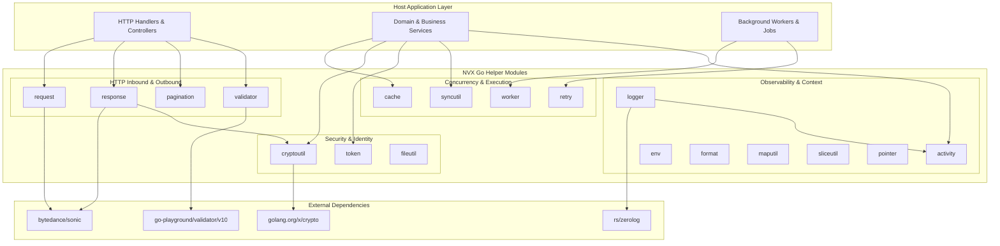
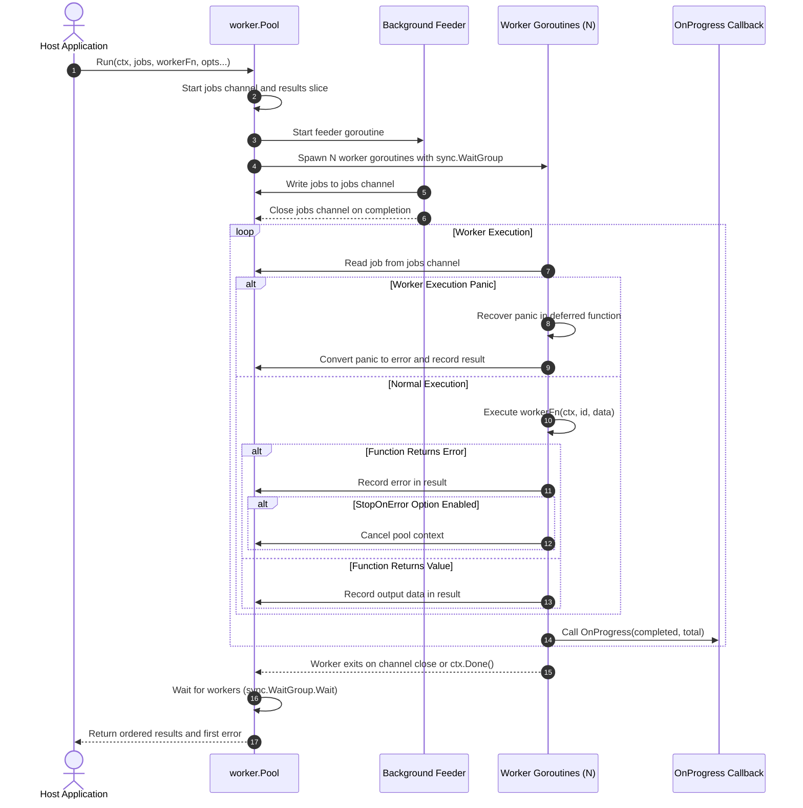
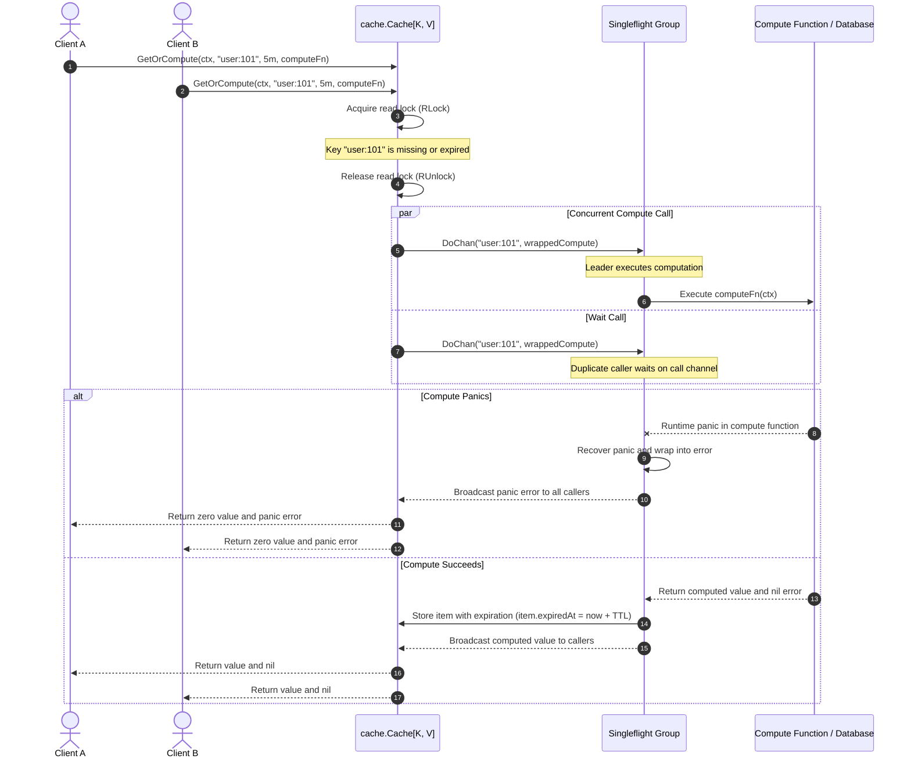
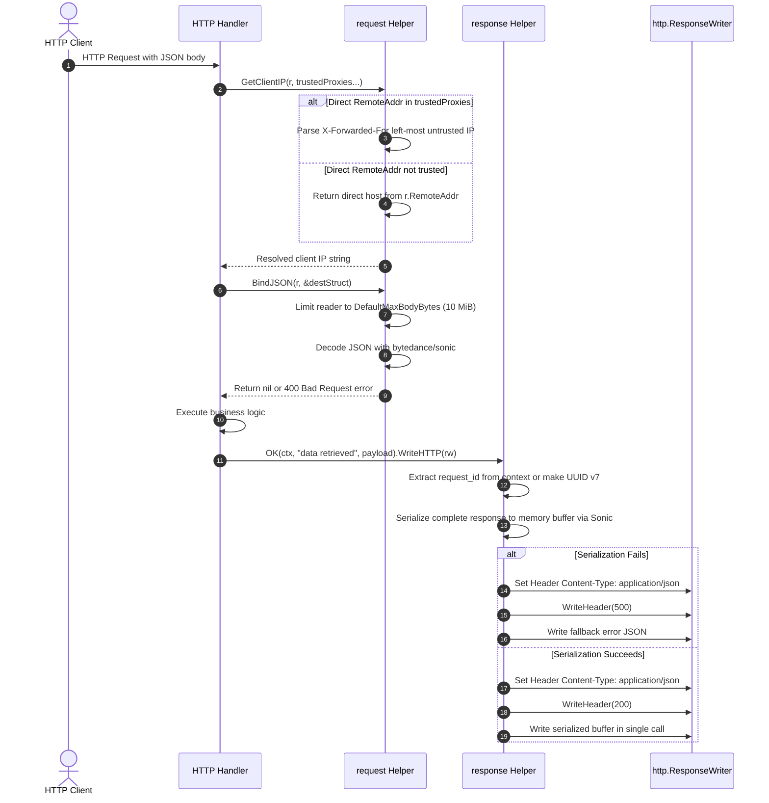
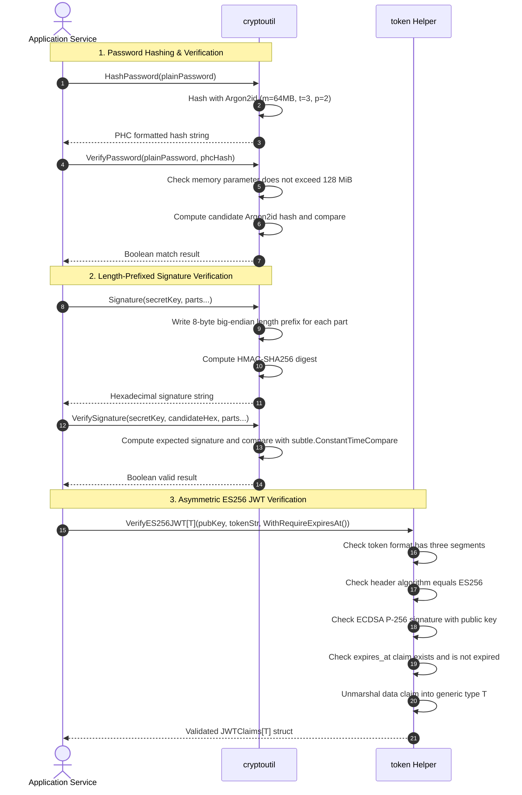
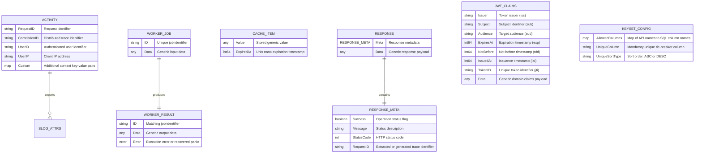
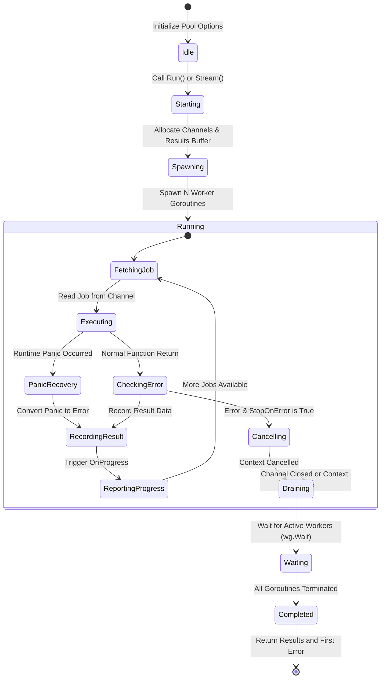
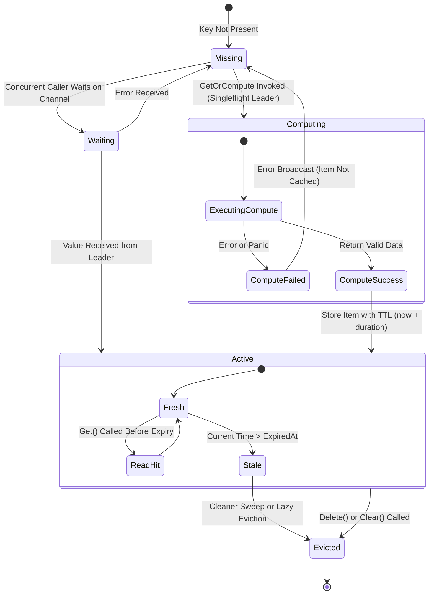
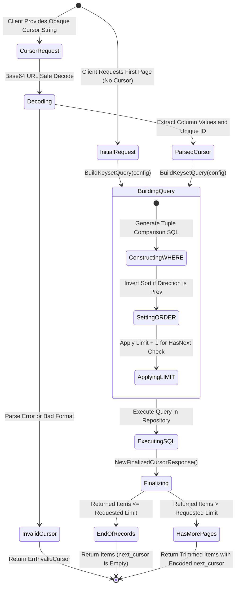

# NVX Go Helper Technical Documentation

[](https://golang.org)
[](LICENSE)
[]()
[]()

---

## 1. System Overview

The `nvx-go-helper` library provides reusable Go modules for backend microservices and HTTP APIs.
The codebase contains eighteen independent utility packages.
The packages provide solutions for cryptography, concurrent worker pools, in-memory caching, request binding, and HTTP responses.
The design prioritizes the Go standard library to maintain minimal external dependencies.
Third-party packages supply specialized capabilities: `bytedance/sonic` for JSON serialization, `rs/zerolog` for structured logging, `go-playground/validator/v10` for struct tag validation, and `golang.org/x/crypto` for Argon2id hashing.
All public APIs use Go generics to guarantee compile-time type safety.
The modules run safely in concurrent environments and prevent goroutine leaks.

---

## 2. System Architecture

The diagram below shows the module organization and external package boundaries.



---

## 3. Core Business Workflows

### 3.1 Worker Pool Task Execution and Stream Processing

The worker pool executes jobs in parallel goroutines.
The pool handles context cancellation, progress updates, and worker panics safely.



#### Procedural Steps (ASD-STE100)
1. Send the job slice and the worker function to `worker.Run` or `worker.Stream`.
2. Configure the worker count and execution options with functional option parameters.
3. The pool starts the worker goroutines and the background feeder goroutine.
4. The feeder goroutine writes jobs to the internal channel.
5. Each worker reads a job and executes the worker function.
6. A deferred recover function catches any runtime panic.
7. The worker records the result data or the returned error.
8. If an error occurs and `StopOnError` is active, the pool cancels the context.
9. The worker executes the progress callback function if configured.
10. The pool waits for all workers to finish.
11. The pool returns the slice of results to the caller.

---

### 3.2 Singleflight In-Memory Cache Retrieval

The cache manages in-memory data with TTL expiration.
It uses singleflight call deduplication to prevent cache stampedes.



#### Procedural Steps (ASD-STE100)
1. Call `GetOrCompute` with the key, TTL duration, and compute function.
2. The cache checks the memory map under a read lock.
3. If an unexpired item exists, the cache returns the value immediately.
4. If the item is missing or expired, the cache calls the singleflight group.
5. The singleflight group starts the compute function for the first caller only.
6. Other concurrent callers wait on a shared result channel.
7. The compute wrapper recovers runtime panics to protect waiting goroutines.
8. If computation succeeds, the cache stores the value with the expiration timestamp.
9. The singleflight group broadcasts the value to all waiting callers.
10. If computation fails or panics, the cache sends the error without caching data.

---

### 3.3 HTTP Request Inbound and Standardized Response Pipeline

The HTTP pipeline inspects client IP addresses, checks body size, decodes JSON, and writes buffered JSON responses.



#### Procedural Steps (ASD-STE100)
1. Pass the incoming HTTP request to `request.GetClientIP` with trusted proxy IPs.
2. The helper parses the `X-Forwarded-For` header only if the proxy is trusted.
3. Call `request.BindJSON` to decode the request body into a destination struct.
4. The helper limits the request body reader to ten megabytes.
5. The helper decodes the payload with the Sonic JSON decoder.
6. The handler executes the application business logic.
7. Call `response.OK` or another response constructor with the context and payload.
8. The response helper serializes the response into a byte buffer before setting headers.
9. If serialization succeeds, the helper writes the headers and the byte buffer.
10. If serialization fails, the helper writes an HTTP 500 status code with fallback JSON.

---

### 3.4 Cryptographic Authentication and Token Verification

The cryptographic modules provide password hashing, length-prefixed signatures, and ECDSA JWT validation.



#### Procedural Steps (ASD-STE100)
1. Hash passwords with `cryptoutil.HashPassword` using default Argon2id parameters.
2. Check passwords with `cryptoutil.VerifyPassword`.
3. The function rejects hashes that require more than 128 megabytes of memory.
4. Generate message signatures with `cryptoutil.Signature`.
5. The signature function adds eight-byte length prefixes to prevent canonicalization attacks.
6. Verify signatures with `cryptoutil.VerifySignature` using constant-time comparison.
7. Validate JWT strings with `token.VerifyES256JWT`.
8. The token helper checks that the header algorithm matches `ES256`.
9. The token helper verifies the ECDSA signature with the public key.
10. If configured, the helper checks that the expiration timestamp exists and remains valid.

---

## 4. Data Model

The diagram below shows the primary data models, structs, and context structures in the library.



---

## 5. State Transitions

### 5.1 Worker Pool Lifecycle

The diagram below shows the lifecycle states of a worker pool execution run.



### 5.2 Cache Item Lifecycle

The diagram below shows the states of an in-memory cache item from computation to eviction.



### 5.3 Keyset Pagination Cursor Lifecycle

The diagram below shows the lifecycle of keyset cursor extraction and SQL query construction.



---

## 6. Setup, Configuration & Runbook

### 6.1 Installation Steps (Procedural STE)
1. Install Go version 1.26 or later on your machine.
2. Add the library to your module with the `go get` command.
```bash
go get github.com/Jkenyut/nvx-go-helper
```
3. Import the required packages into your Go files.

### 6.2 Testing & Static Verification Steps
1. Execute the unit test suite with the race detector enabled.
```bash
go test -v -race ./...
```
2. Check formatting across all Go files.
```bash
gofmt -l .
```
3. Run the Go static analysis tool.
```bash
go vet ./...
```
4. Run the linter to inspect code quality.
```bash
golangci-lint run ./...
```

### 6.3 Configuration Reference Table

| Variable Name | Module | Required | Default | Description (ASD-STE100) |
| :--- | :--- | :--- | :--- | :--- |
| `DefaultMaxBodyBytes` | `request` | No | `10485760` (10 MiB) | Maximum allowed size in bytes for incoming JSON request bodies. |
| `Argon2Params.Memory` | `cryptoutil` | No | `65536` (64 MiB) | Memory size in kibibytes used for password hashing. |
| `Argon2Params.Iterations` | `cryptoutil` | No | `3` | Number of passes over the memory buffer during hashing. |
| `Argon2Params.Parallelism` | `cryptoutil` | No | `2` | Number of concurrent threads used during password hashing. |
| `Argon2Params.SaltLength` | `cryptoutil` | No | `16` | Length in bytes of the random salt for password hashing. |
| `Argon2Params.KeyLength` | `cryptoutil` | No | `32` | Length in bytes of the generated key from password hashing. |
| `MaxArgon2Memory` | `cryptoutil` | No | `131072` (128 MiB) | Maximum memory limit allowed during PHC hash decoding to prevent denial of service. |
| `Config.CleanupInterval` | `cache` | No | `1m` (1 Minute) | Interval duration between automatic background sweeps for expired cache items. |
| `Config.Workers` | `worker` | No | `runtime.NumCPU()` | Number of parallel worker goroutines in the pool. |
| `Config.BufferSize` | `worker` | No | `len(jobs)` | Capacity of the jobs channel in the worker pool. |
| `Config.Timeout` | `worker` | No | `0` (No timeout) | Maximum duration allowed for an individual worker task. |
| `Config.StopOnError` | `worker` | No | `false` | Flag to cancel the pool context upon the first task error. |
| `Config.PreserveOrder` | `worker` | No | `false` | Flag to preserve the input slice ordering in the result slice. |

---

## 7. Package Directory and Reference Examples

| Package | Directory | Description (ASD-STE100) |
| :--- | :--- | :--- |
| **`activity`** | [`/activity`](activity/README.md) | Propagates request metadata across contexts for structured logging. |
| **`cache`** | [`/cache`](cache/README.md) | Provides an in-memory cache with TTL expiration and singleflight deduplication. |
| **`cryptoutil`** | [`/cryptoutil`](cryptoutil/README.md) | Provides Argon2id, AES-256-GCM, ECIES encryption, UUIDs, and HMAC signatures. |
| **`env`** | [`/env`](env/README.md) | Reads environment variables with type-safe fallback values. |
| **`fileutil`** | [`/fileutil`](fileutil/README.md) | Checks file MIME magic bytes and cleans filenames against path traversal. |
| **`format`** | [`/format`](format/README.md) | Formats Indonesian Rupiah, masks sensitive words, and truncates UTF-8 strings. |
| **`logger`** | [`/logger`](logger/README.md) | Provides structured Zerolog logging with diode ring buffers and slog bridges. |
| **`maputil`** | [`/maputil`](maputil/README.md) | Manipulates generic maps: Keys, Values, Merge, Pick, Omit, and Filter. |
| **`pagination`** | [`/pagination`](pagination/README.md) | Builds keyset cursor and offset SQL queries without forced limits. |
| **`pointer`** | [`/pointer`](pointer/README.md) | Converts primitive literal values into pointers. |
| **`request`** | [`/request`](request/README.md) | Decodes JSON with size limits, parses query values, and resolves client IPs. |
| **`response`** | [`/response`](response/README.md) | Writes standardized JSON HTTP responses with pre-buffered encoding. |
| **`retry`** | [`/retry`](retry/README.md) | Executes operations with exponential backoff and leak-free timers. |
| **`sliceutil`** | [`/sliceutil`](sliceutil/README.md) | Manipulates generic slices: Chunk, Map, Filter, Unique, and Contains. |
| **`syncutil`** | [`/syncutil`](syncutil/README.md) | Provides keyed mutexes and parallel slice runners with panic recovery. |
| **`token`** | [`/token`](token/README.md) | Creates and verifies ES256 JWT tokens with algorithm validation. |
| **`validator`** | [`/validator`](validator/README.md) | Validates structs with custom tags for Indonesian ID numbers. |
| **`worker`** | [`/worker`](worker/README.md) | Manages concurrent worker pools with context cancellation and progress tracking. |

---

### 7.1 Activity (`/activity`)
Propagates request metadata across context boundaries for logging and tracing.

```go
import (
    "context"
    "github.com/Jkenyut/nvx-go-helper/activity"
)

// Store metadata in the context
ctx := activity.WithActivity(context.Background(), activity.Activity{
    RequestID:     "req-101",
    CorrelationID: "corr-202",
    UserID:        "user-303",
    UserIP:        "192.168.1.1",
})

// Read values from the context downstream
userID, ok := activity.GetUserID(ctx)
act := activity.FromContext(ctx)

// Convert to slog attributes for log/slog interoperability
attrs := activity.ToSlogAttrs(ctx)
```

---

### 7.2 Cache (`/cache`)
Provides an in-memory cache with TTL expiration and singleflight protection against cache stampedes.

```go
import (
    "context"
    "time"
    "github.com/Jkenyut/nvx-go-helper/cache"
)

// Start cache with a one-minute cleanup interval
c := cache.New[string, UserProfile](cache.WithCleanupInterval(1 * time.Minute))
defer c.Close()

// Retrieve item or compute missing key safely across concurrent goroutines
profile, err := c.GetOrCompute(ctx, "user:101", 5*time.Minute, func(ctx context.Context) (UserProfile, error) {
    return queryUserFromDatabase(ctx, 101)
})
```

---

### 7.3 Cryptoutil (`/cryptoutil`)
Provides cryptographic operations for password hashing, encryption, length-prefixed signatures, and UUIDs.

```go
import "github.com/Jkenyut/nvx-go-helper/cryptoutil"

// 1. Argon2id Password Hashing (PHC format, max 128 MiB memory limit on verification)
hash, err := cryptoutil.HashPassword("MySecretPassword")
valid, err := cryptoutil.VerifyPassword("MySecretPassword", hash)

// 2. Length-Prefixed HMAC-SHA256 Signature (Prevents delimiter collisions)
sig := cryptoutil.Signature("secret-key", "part1", "part2")
isValid := cryptoutil.VerifySignature("secret-key", sig, "part1", "part2")

// 3. ECIES Hybrid Encryption (NIST P-256 + AES-256-GCM)
priv, pub, _ := cryptoutil.GenerateECCKeyPair()
ciphertext, _ := cryptoutil.EncryptECC(pub, []byte("sensitive-payload"))
plaintext, _ := cryptoutil.DecryptECC(priv, ciphertext)

// 4. Time-Ordered UUID v7
id := cryptoutil.V7()
```

---

### 7.4 Env (`/env`)
Extracts environment variables with fallback values.

```go
import "github.com/Jkenyut/nvx-go-helper/env"

port := env.GetInt("APP_PORT", 8080)
host := env.GetString("DB_HOST", "127.0.0.1")
debug := env.GetBool("DEBUG_MODE", false)
```

---

### 7.5 Fileutil (`/fileutil`)
Validates file safety, checks MIME magic bytes, and sanitizes filenames against path traversal.

```go
import "github.com/Jkenyut/nvx-go-helper/fileutil"

// Strip directory components and dangerous characters
safeName := fileutil.SanitizeFileName("../../etc/passwd") // "passwd"

// Check magic bytes for document types (inspects CFBF, OOXML zip, and plain text scripts)
isDoc := fileutil.IsSafeDocument(fileBytes)
isImg := fileutil.IsSafeImage(fileBytes)
```

---

### 7.6 Format (`/format`)
Provides string truncation, keyword masking, and Indonesian localized formatting.

```go
import "github.com/Jkenyut/nvx-go-helper/format"

// Truncate strings safely across multi-byte UTF-8 runes
short := format.Truncate("Belanja Diskon Hari Ini!", 10) // "Belanja..."

// Mask sensitive keywords in JSON or text
masked := format.MaskAfterKeywords(`{"token":"secret123"}`, []string{"token"}, "*")

// Format Indonesian Rupiah currency
idr := format.Rupiah(1500000) // "1.500.000,00"
```

---

### 7.7 Logger (`/logger`)
Structured logging with Zerolog, diode ring buffers, OpenTelemetry tracing, and slog handlers.

```go
import (
    "github.com/Jkenyut/nvx-go-helper/logger"
)

// Start logger with options
logger.Init(
    logger.WithServiceName("account-service"),
    logger.WithEnv("production"),
    logger.WithPort(8080),
)
defer logger.Close()

// Context-aware log with automatic trace ID injection
logger.Info(ctx).Str("action", "login").Msg("user logged in")
```

---

### 7.8 Maputil (`/maputil`)
Generic map operations with capacity pre-allocation to prevent memory rehashing.

```go
import "github.com/Jkenyut/nvx-go-helper/maputil"

m1 := map[string]int{"a": 1, "b": 2}
m2 := map[string]int{"b": 3, "c": 4}

merged := maputil.Merge(m1, m2) // map[a:1 b:3 c:4]
keys := maputil.Keys(m1)         // []string{"a", "b"}
values := maputil.Values(m1)     // []int{1, 2}
picked := maputil.Pick(m1, "a")  // map[a:1]
```

---

### 7.9 Pagination (`/pagination`)
Keyset cursor and offset pagination query building without forced default limits.

```go
import "github.com/Jkenyut/nvx-go-helper/pagination"

allowed := map[string]string{"created_at": "users.created_at", "name": "users.name"}
req := pagination.BindCursorFilterRequest(r, allowed)

keyset, err := req.BuildKeysetQuery(pagination.KeysetConfig{
    AllowedColumns: allowed,
    UniqueColumn:   "id",
    UniqueSortType: "DESC",
})

// Build finalized response with encoded next/prev cursors
resp := pagination.NewFinalizedCursorResponse(users, req.DynamicCursorRequest, extractor.Fn(req.SortBy))
```

---

### 7.10 Pointer (`/pointer`)
Converts literal values into pointers.

```go
import "github.com/Jkenyut/nvx-go-helper/pointer"

enabled := pointer.Of(true)
maxRetries := pointer.Of(3)
```

---

### 7.11 Request (`/request`)
Binds HTTP request bodies, limits payload sizes to 10 MiB, and resolves client IP addresses with trusted proxy validation.

```go
import "github.com/Jkenyut/nvx-go-helper/request"

// 1. Resolve client IP with trusted proxy check
clientIP := request.GetClientIP(r, "10.0.0.1", "172.16.0.1")

// 2. Bind JSON with 10 MiB size limit and struct validation
var payload CreateAccountRequest
if err := request.BindAndValidate(r, &payload); err != nil {
    // Handle error
}
```

---

### 7.12 Response (`/response`)
Writes standard JSON API responses with pre-buffered serialization before header output.

```go
import "github.com/Jkenyut/nvx-go-helper/response"

func Handler(w http.ResponseWriter, r *http.Request) {
    ctx := r.Context()
    
    // Write 200 OK response with metadata and payload
    response.OK(ctx, "account retrieved", account).WriteHTTP(w)
    
    // Write error responses
    // response.BadRequest(ctx, "invalid input").WriteHTTP(w)
    // response.NotFound(ctx, "account not found").WriteHTTP(w)
}
```

---

### 7.13 Retry (`/retry`)
Executes operations with exponential backoff and timer cleanup.

```go
import (
    "time"
    "github.com/Jkenyut/nvx-go-helper/retry"
)

err := retry.Do(func() error {
    return pingExternalService()
},
    retry.WithMaxAttempts(3),
    retry.WithBackoff(200*time.Millisecond, 2.0),
    retry.WithContext(ctx),
)
```

---

### 7.14 Sliceutil (`/sliceutil`)
Generic slice transformation functions.

```go
import "github.com/Jkenyut/nvx-go-helper/sliceutil"

items := []int{1, 2, 3, 4, 5, 6}

chunks := sliceutil.Chunk(items, 2) // [[1, 2], [3, 4], [5, 6]]
evens := sliceutil.Filter(items, func(v int) bool { return v%2 == 0 })
unique := sliceutil.Unique([]string{"a", "b", "a"}) // ["a", "b"]
```

---

### 7.15 Syncutil (`/syncutil`)
Provides per-key mutex locks and bounded parallel slice execution with panic recovery.

```go
import "github.com/Jkenyut/nvx-go-helper/syncutil"

// 1. KeyedMutex for per-entity locking
var userLocks = syncutil.NewKeyedMutex[string]()
unlock := userLocks.Lock("user-101")
defer unlock()

// 2. Parallel slice mapping with panic recovery and order preservation
results, err := syncutil.Map(ctx, userIDs, 4, func(ctx context.Context, id int) (UserProfile, error) {
    return fetchUserProfile(ctx, id)
})
```

---

### 7.16 Token (`/token`)
Generates and checks ES256 JWT tokens with algorithm validation and expiration requirements.

```go
import "github.com/Jkenyut/nvx-go-helper/token"

// Generate ES256 JWT
claims := token.NewJWTClaims(UserPayload{UserID: "101"}, 24*time.Hour)
tokenStr, err := token.GenerateES256JWT(ecdsaPrivateKey, claims)

// Verify token with required expiration check
parsed, err := token.VerifyES256JWT[UserPayload](
    ecdsaPublicKey, 
    tokenStr, 
    token.WithRequireExpiresAt(),
)
```

---

### 7.17 Validator (`/validator`)
Struct validation wrapper for `validator/v10` with custom Indonesian tags.

```go
import "github.com/Jkenyut/nvx-go-helper/validator"

type CustomerProfile struct {
    Email string `validate:"required,email"`
    NIK   string `validate:"required,nik"`      // 16-digit Indonesian NIK
    NPWP  string `validate:"omitempty,npwp"`    // Indonesian NPWP
    Phone string `validate:"required,phone_id"` // Indonesian phone number
}

if err := validator.Struct(profile); err != nil {
    errMap := validator.GetErrorsMap(err) // map[string]string for API responses
}
```

---

### 7.18 Worker (`/worker`)
Concurrent worker pool with context cancellation, progress callbacks, and panic recovery.

```go
import "github.com/Jkenyut/nvx-go-helper/worker"

jobs := []worker.Job[string, int]{
    {ID: "job-1", Data: 10},
    {ID: "job-2", Data: 20},
}

workerFn := func(ctx context.Context, id string, data int) (string, error) {
    return fmt.Sprintf("processed-%d", data), nil
}

// Execute worker pool with functional options
results, err := worker.Run(
    ctx,
    jobs,
    workerFn,
    worker.WithWorkers(4),
    worker.WithPreserveOrder(true),
    worker.WithOnProgress(func(completed, total int) {
        log.Printf("Progress: %d of %d", completed, total)
    }),
)
```

---

## 8. License

This project uses the [Apache License 2.0](LICENSE).
