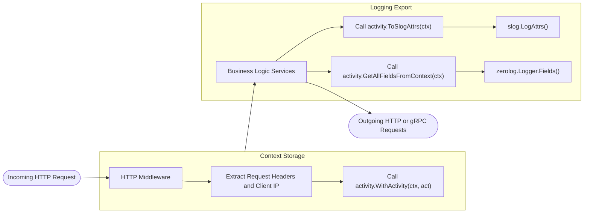

# Activity Helper (`/activity`)

The activity package stores request metadata in Go contexts and exports fields for structured loggers.

## 1. Metadata Propagation Flow

The diagram below shows metadata injection and logger attribute export.



### Procedural Steps (ASD-STE100)
1. Extract request identifiers and client IP addresses in your HTTP middleware.
2. Store the metadata in the request context using `activity.WithActivity`.
3. Read metadata downstream using `activity.FromContext` or field-specific getters.
4. Export metadata to slog using `activity.ToSlogAttrs`.
5. Export metadata to Zerolog using `activity.GetAllFieldsFromContext`.

---

## 2. Usage Examples

### 2.1 Storing Metadata in Context

```go
import (
	"context"

	"github.com/Jkenyut/nvx-go-helper/activity"
)

// Store metadata using the Activity struct
ctx := activity.WithActivity(context.Background(), activity.Activity{
	RequestID:     "req-101",
	CorrelationID: "corr-202",
	UserID:        "user-303",
	UserIP:        "192.168.1.1",
})

// Read individual fields
userID, ok := activity.GetUserID(ctx)
act := activity.FromContext(ctx)
```

### 2.2 Structured Logging Integration

```go
// Export to native log/slog
attrs := activity.ToSlogAttrs(ctx)
slog.LogAttrs(ctx, slog.LevelInfo, "payment processed", attrs...)

// Export to Zerolog
fields := activity.GetAllFieldsFromContext(ctx)
log.Info().Fields(fields).Msg("user updated")
```
