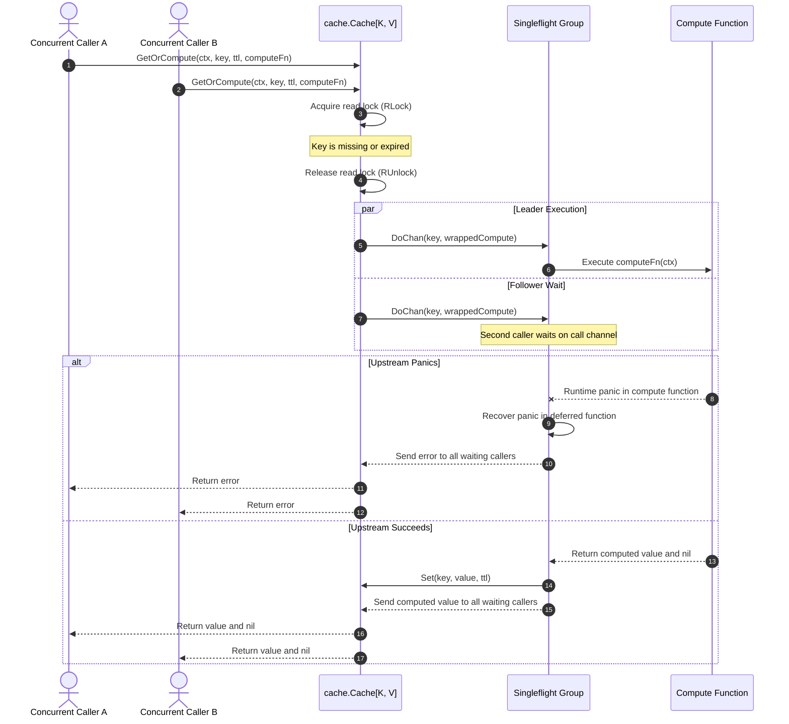
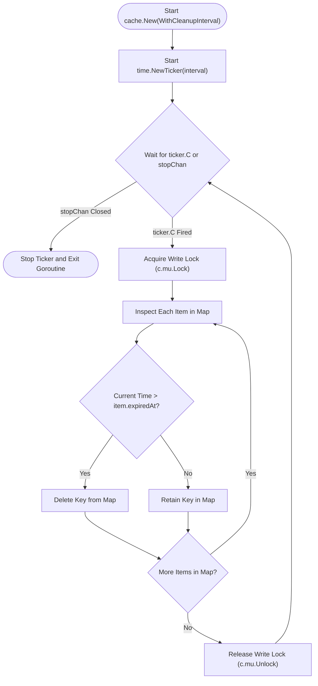

# Cache Helper (`/cache`)

The cache package provides an in-memory generic cache (`Cache[K, V]`).
The cache provides item expiration and duplicate call suppression using the singleflight pattern.

## 1. Singleflight Cache Retrieval Workflow

The sequence diagram below shows concurrent key retrieval and compute deduplication.



### Procedural Steps (ASD-STE100)
1. Call `GetOrCompute` with the key, expiration duration, and compute function.
2. The cache searches the memory map under a read lock.
3. If a valid item exists, the cache returns the value.
4. If the item is missing or expired, the cache forwards the key to the singleflight group.
5. The singleflight group starts the compute function for the first caller only.
6. Other concurrent callers wait on the shared channel.
7. A deferred recover function catches runtime panics in the compute function.
8. If the function succeeds, the cache stores the value with the expiration timestamp.
9. The singleflight group broadcasts the value to all waiting callers.
10. If the function fails or panics, the cache sends the error without storing the value.

---

## 2. Background Eviction Sweeper

The diagram below shows the background cleanup loop.



### Procedural Steps (ASD-STE100)
1. Initialize the cache with `cache.WithCleanupInterval`.
2. The background cleaner starts a timer ticker.
3. On every tick, the cleaner acquires the write lock.
4. The cleaner inspects each item for expiration.
5. The cleaner removes expired items from the map.
6. The cleaner releases the write lock.
7. Call `c.Close()` to stop the ticker and release resources.

---

## 3. Usage Examples

### 3.1 Basic Key Operations

```go
import (
	"time"

	"github.com/Jkenyut/nvx-go-helper/cache"
)

// Start a cache with a 30-second cleanup sweep
c := cache.New[string, UserProfile](cache.WithCleanupInterval(30 * time.Second))
defer c.Close()

// Store an item with 5 minutes TTL
c.Set("user:101", profile, 5*time.Minute)

// Read an item
if profile, ok := c.Get("user:101"); ok {
	// Item exists and is valid
}

// Remove an item or clear all items
c.Delete("user:101")
c.Clear()
```

### 3.2 Singleflight Computation (`GetOrCompute`)

```go
ctx := context.Background()

// 100 concurrent requests trigger exactly 1 database query
profile, err := c.GetOrCompute(ctx, "user:101", 10*time.Minute, func(ctx context.Context) (UserProfile, error) {
	return db.FindUserByID(ctx, 101)
})
if err != nil {
	return err
}
```
