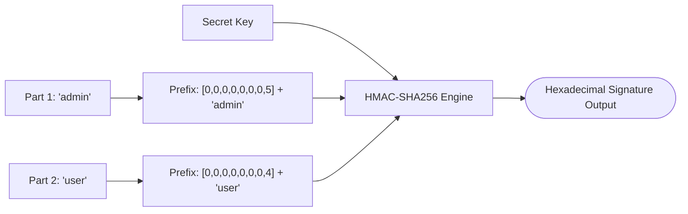

# Cryptoutil (`/cryptoutil`)

The cryptoutil package provides cryptographic primitives: Argon2id password hashing, ECIES hybrid encryption, AES-256-GCM symmetric encryption, UUID generation, and length-prefixed HMAC signatures.

## 1. ECIES Hybrid Encryption Architecture

The functions `cryptoutil.EncryptECC` and `cryptoutil.DecryptECC` implement the Elliptic Curve Integrated Encryption Scheme (ECIES).
The implementation uses the NIST P-256 curve, ECDH key agreement, HKDF-SHA256 key derivation, and AES-256-GCM encryption.

```mermaid
flowchart TD
    subgraph Encrypt ["1. Encryption Flow (cryptoutil.EncryptECC)"]
        Plain["Plaintext Data"]
        RecvPub["Recipient Public Key"]
        GenEphem["Make Ephemeral P-256 Key Pair"]
        ECDH1["ECDH: Ephemeral PrivKey + Recipient PubKey"]
        HKDF1["HKDF-SHA256: Derive 32-byte AES Key"]
        AESGCM1["AES-256-GCM Seal with 12-byte Nonce"]
        Payload(["Combined Output: EphemPubKey || Nonce || Ciphertext+Tag"])

        GenEphem --> ECDH1
        RecvPub --> ECDH1
        ECDH1 --> HKDF1
        HKDF1 --> AESGCM1
        Plain --> AESGCM1
        GenEphem -. Ephemeral Public Key .-> Payload
        AESGCM1 -. Nonce and Ciphertext .-> Payload
    end

    subgraph Decrypt ["2. Decryption Flow (cryptoutil.DecryptECC)"]
        InPayload(["Encrypted Payload Envelope"])
        Split["Parse: EphemPubKey | Nonce | Ciphertext"]
        RecvPriv["Recipient Private Key"]
        ECDH2["ECDH: Recipient PrivKey + Ephem PubKey"]
        HKDF2["HKDF-SHA256: Derive 32-byte AES Key"]
        AESGCM2["AES-256-GCM Open & Verify Tag"]
        DecryptedPlain["Recovered Plaintext"]

        InPayload --> Split
        Split --> ECDH2
        RecvPriv --> ECDH2
        ECDH2 --> HKDF2
        HKDF2 --> AESGCM2
        Split --> AESGCM2
        AESGCM2 --> DecryptedPlain
    end
```



### Procedural Steps (ASD-STE100)
1. Make an ephemeral NIST P-256 key pair.
2. Calculate a shared secret using ECDH with the recipient public key.
3. Derive a 32-byte AES key using HKDF-SHA256 from the shared secret.
4. Encrypt the plaintext data with AES-256-GCM and a random 12-byte nonce.
5. Combine the ephemeral public key, nonce, and ciphertext into an envelope payload.
6. To decrypt, parse the envelope into the three components.
7. Calculate the shared secret using ECDH with the recipient private key.
8. Decrypt the ciphertext and check the authentication tag.

---

## 2. Length-Prefixed Signature Architecture

The function `cryptoutil.Signature` writes eight-byte length prefixes for each input part to eliminate delimiter collision attacks.



### Procedural Steps (ASD-STE100)
1. Pass the secret key and message parts to `cryptoutil.Signature`.
2. The function writes the eight-byte big-endian length of each part before writing its bytes.
3. The function calculates the HMAC-SHA256 digest.
4. The function returns the hexadecimal signature string.
5. Check signatures with `cryptoutil.VerifySignature` using constant-time comparison.

---

## 3. Usage Examples

```go
import "github.com/Jkenyut/nvx-go-helper/cryptoutil"

// 1. Password Hashing (Argon2id with 128 MiB memory limit during verification)
hash, err := cryptoutil.HashPassword("securePassword123")
valid, err := cryptoutil.VerifyPassword("securePassword123", hash)

// 2. Length-Prefixed Signature
sig := cryptoutil.Signature("my-secret-key", "userId", "action")
validSig := cryptoutil.VerifySignature("my-secret-key", sig, "userId", "action")

// 3. Hybrid Asymmetric Encryption (ECIES)
privKey, pubKey, _ := cryptoutil.GenerateECCKeyPair()
ciphertext, _ := cryptoutil.EncryptECC(pubKey, []byte("sensitive payload"))
plaintext, _ := cryptoutil.DecryptECC(privKey, ciphertext)

// 4. Symmetric Encryption (AES-256-GCM)
enc, _ := cryptoutil.NewAESGCMFromHex("0123456789abcdef0123456789abcdef0123456789abcdef0123456789abcdef")
sealed, _ := enc.Encrypt(map[string]any{"user_id": 123})

// 5. UUID Identifiers
uuidV4 := cryptoutil.V4()
uuidV7 := cryptoutil.V7()
```
