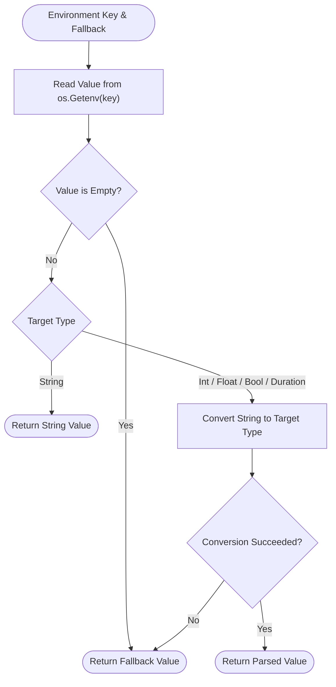

# Environment Helper (`/env`)

The env package reads environment variables and returns fallback values when keys are missing or invalid.

## 1. Environment Extraction Flowchart

The diagram below shows the lookup and fallback parsing logic.



### Procedural Steps (ASD-STE100)
1. Call the typed helper function with the environment key name and the fallback default value.
2. The helper reads the environment variable from the operating system.
3. If the variable is unset or empty, the helper returns the fallback default.
4. If type conversion fails, the helper returns the fallback default without panicking.
5. The function returns the converted value to the caller.

---

## 2. Usage Examples

```go
import (
	"time"

	"github.com/Jkenyut/nvx-go-helper/env"
)

// Read string value with fallback
dbHost := env.GetString("DB_HOST", "127.0.0.1")

// Read integer value with fallback
port := env.GetInt("PORT", 8080)

// Read boolean value with fallback (parses "true", "1", "yes", "on")
debug := env.GetBool("DEBUG", false)

// Read float64 value with fallback
rate := env.GetFloat64("RATE_LIMIT", 100.5)

// Read duration value with fallback
timeout := env.GetDuration("REQUEST_TIMEOUT", 10*time.Second)

// Read comma-separated string slice with fallback
corsOrigins := env.GetSlice("CORS_ORIGINS", []string{"*"})
```
