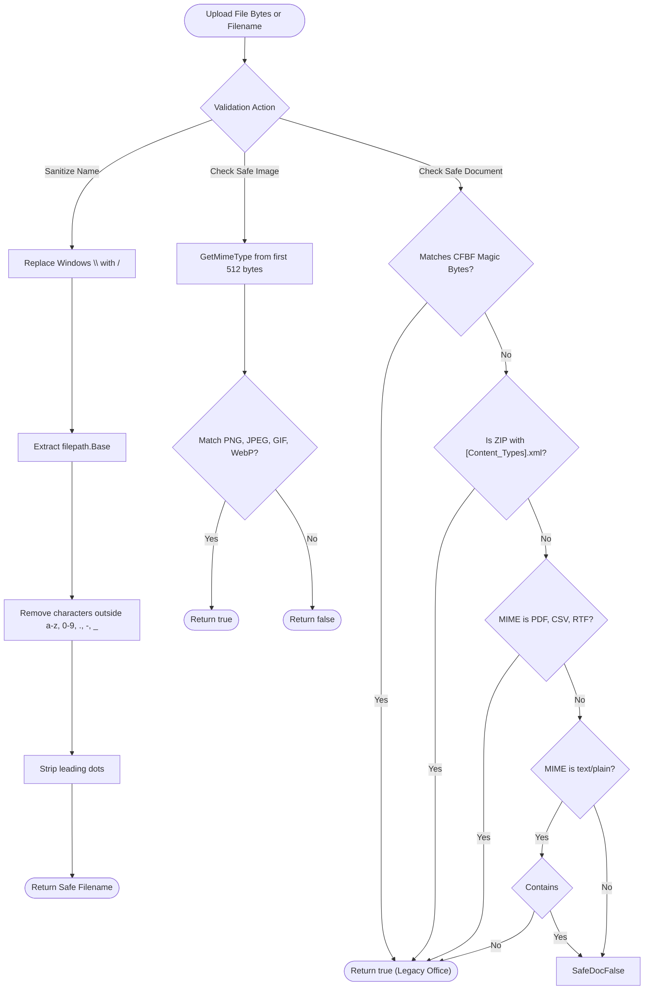

# File Utilities (`/fileutil`)

The fileutil package checks file magic bytes, detects Microsoft Office documents, inspects plain text scripts, and removes path traversal sequences.

## 1. File Inspection Flow

The diagram below shows the file validation and filename sanitization logic.



### Procedural Steps (ASD-STE100)
1. Pass uploaded file bytes to `fileutil.IsSafeDocument` or `fileutil.IsSafeImage`.
2. The helper inspects the initial 512 bytes for matching MIME magic bytes.
3. For documents, the helper checks legacy CFBF headers and modern zipped OOXML structures.
4. For plain text files, the helper checks for embedded scripts or shell shebangs.
5. Pass filenames to `fileutil.SanitizeFileName` before storing files on the filesystem.
6. The function strips directory separators and characters outside the approved character set.

---

## 2. Usage Examples

```go
import "github.com/Jkenyut/nvx-go-helper/fileutil"

// 1. Sanitize file name against path traversal
cleanName := fileutil.SanitizeFileName("../../etc/passwd.png") // "passwd.png"

// 2. Identify MIME type from magic bytes
mimeType := fileutil.GetMimeType(fileBytes) // "image/png"

// 3. Inspect document and image safety
isDoc := fileutil.IsSafeDocument(fileBytes)
isImg := fileutil.IsSafeImage(fileBytes)

// 4. Format byte sizes for display
displaySize := fileutil.FormatFileSize(2097152) // "2.0 MB"
```
