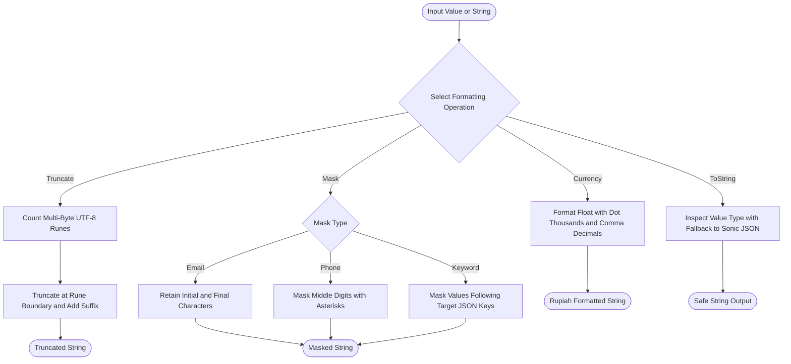

# Format Helper (`/format`)

The format package formats currencies, masks sensitive strings, converts values to strings safely, and calculates date boundaries.

## 1. Formatting Operations Flowchart

The diagram below shows the primary formatting and masking functions.



### Procedural Steps (ASD-STE100)
1. Pass the input value to the target formatting function.
2. For strings, call `Truncate` with the maximum rune limit.
3. For sensitive strings, call `MaskEmail`, `MaskPhone`, or `MaskAfterKeywords`.
4. For numbers, call `Rupiah` or `FormatRupiah` to generate Indonesian currency formats.
5. For generic values, call `ToString` to produce a non-panicking string representation.

---

## 2. Usage Examples

### 2.1 Currency and Account Number Formatting

```go
import "github.com/Jkenyut/nvx-go-helper/format"

// Format Indonesian Rupiah currency with decimals
idr := format.Rupiah(1250000.50) // "1.250.000,50"

// Format Indonesian Rupiah without decimals
idrShort := format.FormatRupiah(1500000) // "Rp 1.500.000"

// Format BRI bank account number into standard chunks
accountNo := format.BRINorek("123456789012345") // "1234-56-789012-34-5"
```

### 2.2 Sensitive Data Masking

```go
// Mask email addresses
maskedEmail := format.MaskEmail("budi.santoso@example.com") // "bu***so@example.com"

// Mask phone numbers
maskedPhone := format.MaskPhone("081234567890") // "0812****7890"

// Mask values following sensitive keys in JSON payloads
jsonPayload := `{"password":"secret123","token":"xyz"}`
maskedJSON := format.MaskAfterKeywords(jsonPayload, []string{"password", "token"}, "*")
```

### 2.3 UTF-8 Rune Truncation and Safe String Conversion

```go
// Truncate strings safely across multi-byte UTF-8 runes
short := format.Truncate("Belajar Pemrograman Go", 10, "...") // "Belajar..."

// Convert any value to string safely without panics
strInt := format.ToString(100)           // "100"
strBool := format.ToString(true)         // "true"
strTime := format.ToString(format.Now()) // "2026-10-25T00:00:00Z"
```

### 2.4 Calendar Date Boundaries

```go
import "time"

now := time.Now()

// Calculate start and end boundaries
dayStart := format.StartOfDay(now)
monthEnd := format.EndOfMonth(now)
yearStart := format.StartOfYear(now)
```
