# Logger Helper (`/logger`)

The logger package wraps Zerolog to provide structured logging, diode ring buffers, OpenTelemetry trace extraction, and standard library `log/slog` handlers.

## 1. Logging Pipeline Architecture

The diagram below shows context extraction, diode buffering, and output sinks.

```mermaid
flowchart TD
    LogCall(["Call logger.Info(ctx) or logger.Slog()"]) --> ContextExtract["Extract TraceID, RequestID, and Activity Metadata"]
    ContextExtract --> CheckHandler{"Logger Target"}

    CheckHandler -- Zerolog Call --> FormatEvent["Create Zerolog Event with Fields"]
    CheckHandler -- slog Call --> HandleRecord["Process Record with Slog Handler and Groups"]

    FormatEvent & HandleRecord --> CheckEnv{"Environment Setting"}

    CheckEnv -- Production --> DiodeBuffer["Write to Non-blocking Diode Ring Buffer"]
    DiodeBuffer --> JSONSink["Flush JSON Lines to stdout"]

    CheckEnv -- Development --> ConsoleSink["Format Colored Output to stderr"]
```



### Procedural Steps (ASD-STE100)
1. Initialize the logger with `logger.Init` and functional options.
2. Provide the service name, environment, and optional port.
3. Call `defer logger.Close()` in `main.go` to flush pending log entries.
4. Pass the context to `logger.Info(ctx)` to attach trace and activity identifiers.
5. Use `logger.Slog()` or `logger.SlogWithContext(ctx)` when libraries require a `*slog.Logger`.

---

## 2. Usage Examples

### 2.1 Initialization

```go
import (
	"context"

	"github.com/Jkenyut/nvx-go-helper/logger"
)

// Initialize logger with functional options
logger.Init(
	logger.WithServiceName("user-service"),
	logger.WithEnv("production"),
	logger.WithPort(8080),
	logger.WithLevel("info"),
)
defer logger.Close()

// Context-aware log with automatic trace extraction
logger.Info(ctx).Str("action", "checkout").Msg("order placed")
```

### 2.2 Standard Library `log/slog` Interoperability

```go
// Obtain a standard library *slog.Logger backed by Zerolog
appSlog := logger.Slog()

// Or with request context extraction
reqSlog := logger.SlogWithContext(ctx)
reqSlog.Info("processing transaction", "account_id", 101)
```
