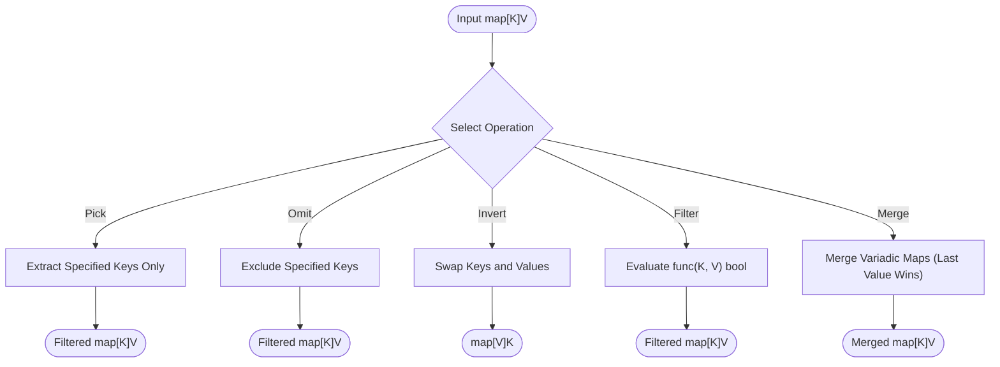

# Map Utilities (`/maputil`)

The maputil package provides generic manipulation functions for Go maps.
The package pre-allocates memory capacity to eliminate hash map resizing overhead.

## 1. Map Manipulation Flowchart

The diagram below shows the primary map operation pathways.



### Procedural Steps (ASD-STE100)
1. Pass the source map to the target manipulation function.
2. Provide keys or a filter predicate function where required.
3. The helper pre-calculates the slice or map capacity.
4. The helper builds a new map without mutating input arguments.
5. The function returns the resulting map or slice.

---

## 2. Usage Examples

### 2.1 Extraction and Key Selection

```go
import "github.com/Jkenyut/nvx-go-helper/maputil"

m := map[string]int{"a": 1, "b": 2, "c": 3}

// Extract keys and values
keys := maputil.Keys(m)     // ["a", "b", "c"]
values := maputil.Values(m) // [1, 2, 3]

// Select matching keys
subset := maputil.Pick(m, "a", "c") // map[string]int{"a": 1, "c": 3}

// Exclude specified keys
omitted := maputil.Omit(m, "b") // map[string]int{"a": 1, "c": 3}
```

### 2.2 Merging and Inverting

```go
m1 := map[string]int{"a": 1, "b": 2}
m2 := map[string]int{"b": 20, "c": 30}

// Merge maps with pre-allocated capacity (later maps overwrite earlier keys)
merged := maputil.Merge(m1, m2) // map[a:1 b:20 c:30]

// Swap keys and values
inverted := maputil.Invert(m1) // map[int]string{1: "a", 2: "b"}
```

### 2.3 Filtering and Searching

```go
m := map[string]int{"apple": 5, "banana": 2, "cherry": 8}

// Filter entries with a predicate
filtered := maputil.Filter(m, func(k string, v int) bool {
	return v >= 5
}) // map["apple":5, "cherry":8]

// Check if a key or value exists
hasApple := maputil.ContainsKey(m, "apple") // true
hasTen := maputil.ContainsValue(m, 10)       // false
```

### 2.4 Constructing from Entries

```go
entries := []maputil.Entry[string, int]{
	{Key: "first", Value: 100},
	{Key: "second", Value: 200},
}

m := maputil.FromEntries(entries) // map["first":100, "second":200]
```
