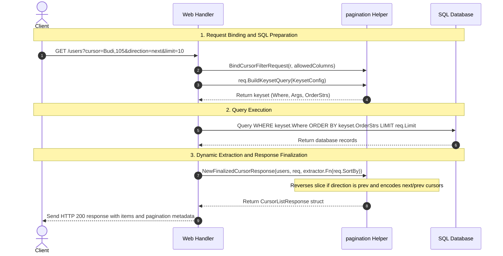

# Pagination Helper (`/pagination`)

The pagination package provides keyset cursor pagination and offset pagination for SQL queries.
It includes whitelisted parameter filtering, type normalization, and standardized generic response structures.

## 1. Keyset Cursor Lifecycle Sequence Diagram

The diagram below shows cursor binding, query generation, and response finalization.



### Procedural Steps (ASD-STE100)
1. Read the HTTP request with `pagination.BindCursorFilterRequest`.
2. Provide the map of approved columns to prevent SQL injection.
3. Call `req.BuildKeysetQuery` with unique tie-breaker column parameters.
4. Apply the returned WHERE clause and ORDER BY clauses to your SQL query.
5. Execute the database query with the requested limit.
6. Pass the database records and field extractor to `NewFinalizedCursorResponse`.
7. The helper inverts backwards slices and encodes cursor strings.
8. Send the standardized response struct to the HTTP client.

---

## 2. Usage Examples

### 2.1 Traditional Offset Pagination

```go
import "github.com/Jkenyut/nvx-go-helper/pagination"

// 1. In Handler: Extract pagination parameters and filters safely
allowedFilters := map[string]string{
	"status": "users.status",
	"role":   "roles.name",
}
req := pagination.BindOffsetFilterRequest(r, allowedFilters)

// 2. In Repository: Calculate SQL offset and limit
totalCount := 150
pageData := req.Pagination(totalCount)

// 3. In Response: Build generic response struct
resp := pagination.NewListResponse(users, pageData)
response.OK(ctx, "success", resp).WriteHTTP(w)
```

**JSON Output Format:**
```json
{
  "items": [],
  "pagination": {
    "page": 2,
    "limit": 10,
    "total": 150,
    "total_pages": 15,
    "has_next": true,
    "has_prev": true,
    "next_page": 3,
    "prev_page": 1
  }
}
```

---

### 2.2 Dynamic Keyset Cursor Pagination

```go
import "github.com/Jkenyut/nvx-go-helper/pagination"

// 1. In Handler: Parse query parameters and decode cursor
allowedColumns := map[string]string{
	"name":       "user_name",
	"created_at": "user_created_at",
}
req := pagination.BindCursorFilterRequest(r, allowedColumns)

// 2. In Repository: Generate SQL clauses in one call
keyset, err := req.BuildKeysetQuery(pagination.KeysetConfig{
	AllowedColumns: allowedColumns,
	UniqueColumn:   "user_id",
	UniqueSortType: "DESC",
})
if err != nil {
	// Handle cursor syntax error
}

// 3. In Service: Build extractor and finalize response
extractor := pagination.NewFieldExtractor(map[string]func(u User) any{
	"name":       func(u User) any { return u.Name },
	"created_at": func(u User) any { return u.CreatedAt },
}, func(u User) any { return u.ID })

resp := pagination.NewFinalizedCursorResponse(users, req.DynamicCursorRequest, extractor.Fn(req.SortBy))
response.OK(ctx, "success", resp).WriteHTTP(w)
```

**JSON Output Format:**
```json
{
  "items": [],
  "pagination": {
    "limit": 10,
    "next_cursor": "Budi,105",
    "prev_cursor": "Agus,10",
    "has_next": true
  }
}
```

---

### 2.3 Unified Mode (Hybrid Endpoint)

Unified mode supports both offset and cursor pagination on a single API route:

```go
req := pagination.BindUnifiedFilterRequest(r, allowedFilters, 100)

if req.IsCursor {
	// Keyset cursor processing branch
	keyset, err := req.BuildKeysetQuery(pagination.KeysetConfig{
		AllowedColumns: allowedColumns,
		UniqueColumn:   "id",
		Detector:       pagination.NewTypeDetector().WithIntegerSuffixes("id"),
	})
	resp := pagination.NewUnifiedFinalizedCursorResponse(users, req, extractor.Fn(req.GetSortBy()))
	response.OK(ctx, "success", resp).WriteHTTP(w)
} else {
	// Offset processing branch
	totalCount := 150
	pageData := req.Pagination(totalCount)
	resp := pagination.NewUnifiedOffsetResponse(users, pageData)
	response.OK(ctx, "success", resp).WriteHTTP(w)
}
```

---

## 3. Query Parameter Filtering

The binder parses two filter styles:

1. **Grouped Syntax:**
   ```
   GET /users?filter=status:active,pending&filter=role:admin
   ```
2. **Direct Parameter Syntax:**
   ```
   GET /users?status=active,pending&role=admin
   ```

### Security Rules:
- The parser rejects query keys that do not match `allowedFilters`.
- The parser collapses duplicate filter values into unique slices.
- The binder reads search terms using `req.Search`.
- The binder caps requested limits using max limit limits.

---

## 4. Column Type Normalization

The package normalizes filter strings into native Go types for database drivers:

```go
// Normalize filter values based on column type
val, err := req.NormalizedFilterValue("users.is_active") // returns bool(true)
ids, err := req.NormalizedFilterValue("users.id")        // returns []int64{1, 2, 3}

// Normalize cursor values against sorting columns
sqlArgs, err := req.NormalizedCursorValues(sortRes.Columns)
```
