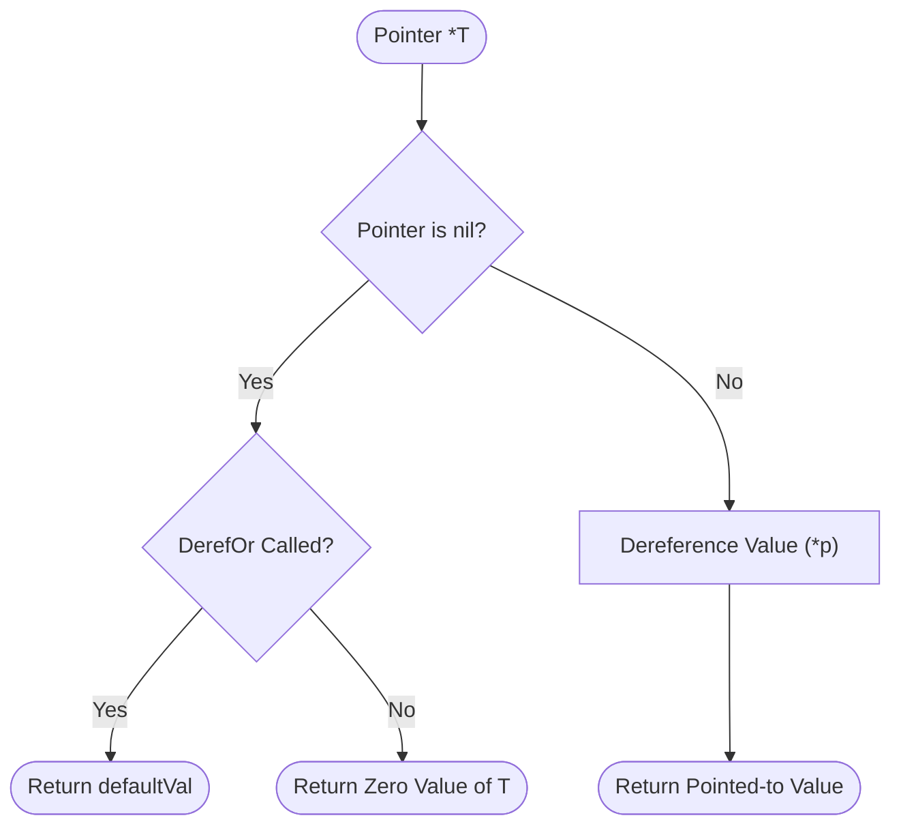

# Pointer Helper (`/pointer`)

The pointer package converts primitive literal values into pointers and provides safe pointer dereferencing with fallbacks.

## 1. Pointer Dereference Flowchart

The diagram below shows the safe dereferencing logic.



### Procedural Steps (ASD-STE100)
1. Call `pointer.Of(value)` to convert a literal or variable into a pointer.
2. Call `pointer.Deref(ptr)` to dereference a pointer with a zero value fallback.
3. Call `pointer.DerefOr(ptr, defaultVal)` to dereference a pointer with a custom fallback value.

---

## 2. Usage Examples

```go
import (
	"time"

	"github.com/Jkenyut/nvx-go-helper/pointer"
)

// Convert literals into pointers
isActive := pointer.Of(true)            // *bool
maxRetries := pointer.Of(5)             // *int
status := pointer.Of("active")          // *string
createdAt := pointer.Of(time.Now())     // *time.Time

// Safe dereference with zero value fallback
val := pointer.Deref(isActive)          // true
empty := pointer.Deref[string](nil)     // ""

// Safe dereference with custom fallback value
count := pointer.DerefOr[int](nil, 10)  // 10
```
