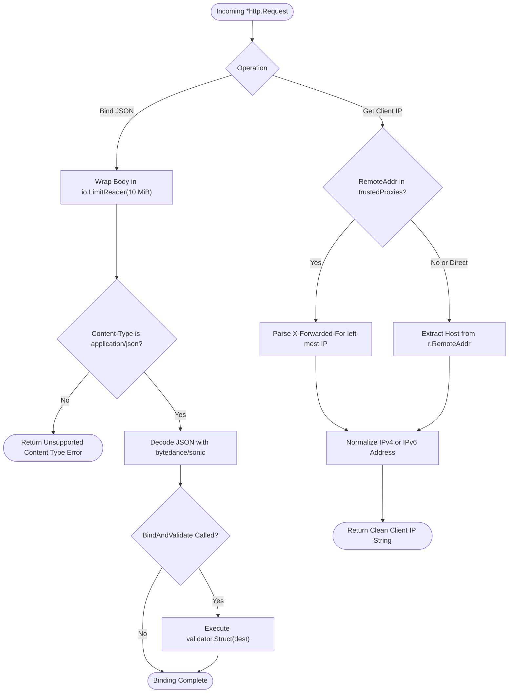

# Request Helper (`/request`)

The request package decodes HTTP request bodies, extracts typed query parameters, and resolves client IP addresses with trusted proxy validation.

## 1. Request Processing and IP Resolution Flow

The diagram below shows the request binding and IP address resolution logic.



### Procedural Steps (ASD-STE100)
1. Pass the incoming HTTP request to `request.GetClientIP` with trusted proxy IP addresses.
2. The helper parses the `X-Forwarded-For` header only if the proxy is trusted.
3. Call `request.BindJSON` to decode the request body into a destination struct.
4. The helper limits the request body reader to ten megabytes.
5. The helper decodes the payload with the Sonic JSON decoder.
6. The handler executes the application business logic.

---

## 2. Usage Examples

### 2.1 JSON Binding and Validation

```go
import "github.com/Jkenyut/nvx-go-helper/request"

type CreateUserRequest struct {
	Name  string `json:"name" validate:"required"`
	Email string `json:"email" validate:"required,email"`
}

var req CreateUserRequest
if err := request.BindAndValidate(r, &req); err != nil {
	// Returns JSON decoding error or struct validation error
}
```

### 2.2 Client IP Resolution with Trusted Proxies

```go
// Specify trusted upstream load balancers or proxy IP addresses
clientIP := request.GetClientIP(r, "10.0.0.1", "172.16.0.1")
```

### 2.3 URL Query Parameter Extraction

```go
page := request.GetQueryInt(r, "page", 1)
status := request.GetQueryString(r, "status", "active")
isActive := request.GetQueryBool(r, "is_active", true)
tags := request.GetQuerySlice(r, "tags", []string{"news"})
```
