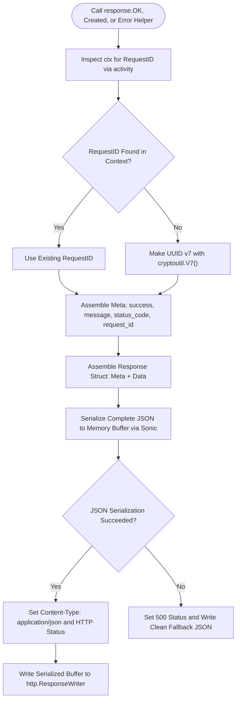

# Response Helper (`/response`)

The response package provides standardized JSON API response structures and HTTP writing functions using `bytedance/sonic`.

## 1. Response Architecture and Writing Lifecycle

The diagram below shows the response construction and serialized buffer output.



### Procedural Steps (ASD-STE100)
1. Call `response.OK` or an error constructor with the context, message, and payload.
2. The helper reads the request identifier from the context or generates a UUID v7 identifier.
3. The helper builds the `Meta` struct with status codes and lowercase messages.
4. The helper serializes the response struct into a byte buffer using Sonic.
5. If serialization succeeds, the helper writes the HTTP header and the byte buffer.
6. If serialization fails, the helper writes an HTTP 500 error without corrupting the output stream.

---

## 2. Usage Examples

### 2.1 Success Responses

```go
import "github.com/Jkenyut/nvx-go-helper/response"

// 200 OK:
response.OK(ctx, "user profile retrieved", userProfile).WriteHTTP(w)

// 201 Created:
response.Created(ctx, "order placed successfully", createdOrder).WriteHTTP(w)
```

**JSON Output Format:**
```json
{
  "meta": {
    "success": true,
    "message": "user profile retrieved",
    "status_code": 200,
    "request_id": "0192c84f-7f89-7000-8000-123456789abc"
  },
  "data": {
    "id": 105,
    "name": "Budi"
  }
}
```

### 2.2 Error Responses

```go
// 400 Bad Request
response.BadRequest(ctx, "invalid transaction payload", nil).WriteHTTP(w)

// 422 Unprocessable Entity
response.UnprocessableEntity(ctx, "validation failed", validationErrorsMap).WriteHTTP(w)

// 500 Internal Server Error
response.InternalServerError(ctx, "failed to process transaction", nil).WriteHTTP(w)
```
