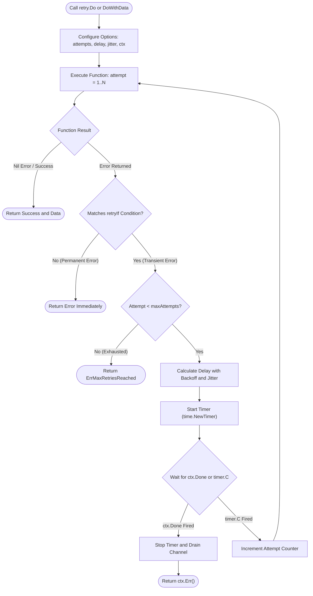

# Retry Helper (`/retry`)

The retry package executes functions with configurable exponential backoff, randomized jitter, and context cancellation.

## 1. Retry Execution Logic

The diagram below shows the retry evaluation loop and timer hygiene.



### Procedural Steps (ASD-STE100)
1. Pass the target function and execution options to `retry.Do` or `retry.DoWithData`.
2. Configure the maximum retry attempts, backoff factor, and context.
3. The helper executes the function.
4. If the function succeeds, the helper returns the result immediately.
5. If an error occurs, the helper evaluates the `RetryIf` condition.
6. If the error is permanent, the helper returns the error without retrying.
7. If the error is transient, the helper calculates the backoff delay.
8. The helper starts a timer and waits for timer completion or context cancellation.
9. If the context cancels, the helper stops the timer and returns the context error.
10. The helper repeats the loop until the function succeeds or attempts expire.

---

## 2. Usage Examples

### 2.1 Simple Retry

```go
import (
	"context"
	"time"

	"github.com/Jkenyut/nvx-go-helper/retry"
)

err := retry.Do(func() error {
	return callExternalPaymentGateway()
},
	retry.WithMaxAttempts(4),
	retry.WithBackoff(100*time.Millisecond, 2.0),
	retry.WithJitter(0.2),
	retry.WithContext(ctx),
)
```

### 2.2 Retry with Return Value and Condition Filter

```go
user, err := retry.DoWithData(func() (*User, error) {
	return fetchUserFromRPC(userID)
},
	retry.WithMaxAttempts(3),
	retry.WithRetryIf(func(err error) bool {
		// Retry transient network errors only
		return isTemporaryNetworkError(err)
	}),
)
```
