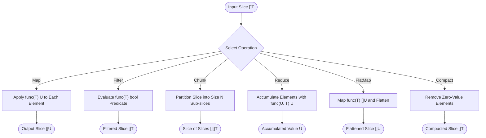
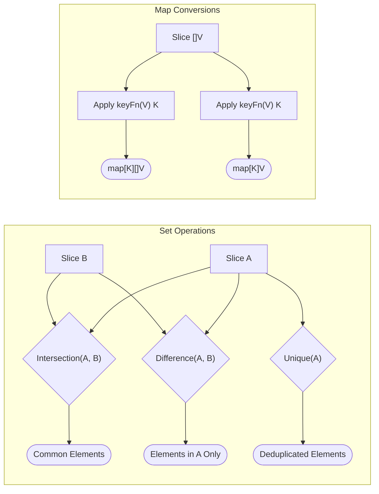

# Slice Utilities (`/sliceutil`)

The sliceutil package provides generic transformation and set operation functions for Go slices.
The package uses Go generics to deliver compile-time type safety without reflection.

## 1. Slice Transformation and Pipeline Architecture

The diagram below shows the primary data transformation functions.



### Procedural Steps (ASD-STE100)
1. Pass the source slice to the desired transformation function.
2. Supply a transformation function or filter predicate where required.
3. The helper pre-calculates capacity to prevent unnecessary memory allocations.
4. The helper iterates through the elements in the slice.
5. The function returns a new slice without modifying the original slice.

---

## 2. Set Operations and Grouping Flow

The diagram below shows set comparison and map conversion operations.



### Procedural Steps (ASD-STE100)
1. Call `sliceutil.Unique` to remove duplicate elements while preserving order.
2. Pass two slices to `sliceutil.Intersection` to extract matching elements.
3. Pass two slices to `sliceutil.Difference` to extract elements present in the first slice only.
4. Pass a slice and a key extraction function to `sliceutil.GroupBy` to group elements by key.
5. Pass a slice and a key extraction function to `sliceutil.ToMap` to build a lookup map.

---

## 3. Usage Examples

### 3.1 Mapping and Transforming

```go
import (
	"fmt"
	"strconv"

	"github.com/Jkenyut/nvx-go-helper/sliceutil"
)

numbers := []int{1, 2, 3, 4}

// Map elements to string values
strings := sliceutil.Map(numbers, func(n int) string {
	return strconv.Itoa(n)
}) // ["1", "2", "3", "4"]

// FlatMap elements into slices and flatten results
repeated := sliceutil.FlatMap(numbers, func(n int) []string {
	return []string{fmt.Sprintf("%da", n), fmt.Sprintf("%db", n)}
}) // ["1a", "1b", "2a", "2b", "3a", "3b", "4a", "4b"]

// Reduce elements into a single aggregate value
sum := sliceutil.Reduce(numbers, 0, func(acc, n int) int {
	return acc + n
}) // 10
```

### 3.2 Filtering and Compacting

```go
numbers := []int{0, 1, 2, 0, 3, 4}

// Filter elements using a predicate
evens := sliceutil.Filter(numbers, func(n int) bool {
	return n%2 == 0
}) // [0, 2, 0, 4]

// Remove zero-value elements
compacted := sliceutil.Compact(numbers) // [1, 2, 3, 4]
```

### 3.3 Chunking, Flattening, and Reversal

```go
items := []string{"a", "b", "c", "d", "e"}

// Split slice into chunks of size 2
chunks := sliceutil.Chunk(items, 2) // [["a", "b"], ["c", "d"], ["e"]]

// Flatten slice of slices
flattened := sliceutil.Flatten(chunks) // ["a", "b", "c", "d", "e"]

// Reverse element order without mutating input
reversed := sliceutil.Reverse(items) // ["e", "d", "c", "b", "a"]
```

### 3.4 Set Operations

```go
listA := []string{"apple", "banana", "cherry"}
listB := []string{"banana", "date", "fig"}

// Extract shared elements
common := sliceutil.Intersection(listA, listB) // ["banana"]

// Extract elements in listA but missing from listB
diff := sliceutil.Difference(listA, listB) // ["apple", "cherry"]

// Deduplicate slice while preserving first appearance order
dupes := []int{1, 2, 2, 3, 1, 4}
unique := sliceutil.Unique(dupes) // [1, 2, 3, 4]
```

### 3.5 Searching and Lookups

```go
items := []string{"red", "green", "blue"}

// Check if element exists
hasBlue := sliceutil.Contains(items, "blue") // true

// Find index of element
index := sliceutil.IndexOf(items, "green") // 1

// Find first element matching predicate
item, found := sliceutil.Find(items, func(s string) bool {
	return len(s) == 5
}) // ("green", true)

// Read last element safely
lastItem, ok := sliceutil.Last(items) // ("blue", true)
```

### 3.6 Map Conversions and Grouping

```go
type User struct {
	ID   int
	Role string
}

users := []User{
	{ID: 1, Role: "admin"},
	{ID: 2, Role: "member"},
	{ID: 3, Role: "admin"},
}

// Group elements by key
byRole := sliceutil.GroupBy(users, func(u User) string {
	return u.Role
}) // map["admin":[{ID:1}, {ID:3}], "member":[{ID:2}]]

// Build lookup map by key
byID := sliceutil.ToMap(users, func(u User) int {
	return u.ID
}) // map[1:{Role:"admin"}, 2:{Role:"member"}, 3:{Role:"admin"}]
```
