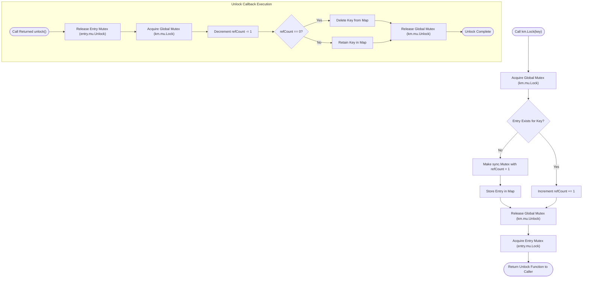
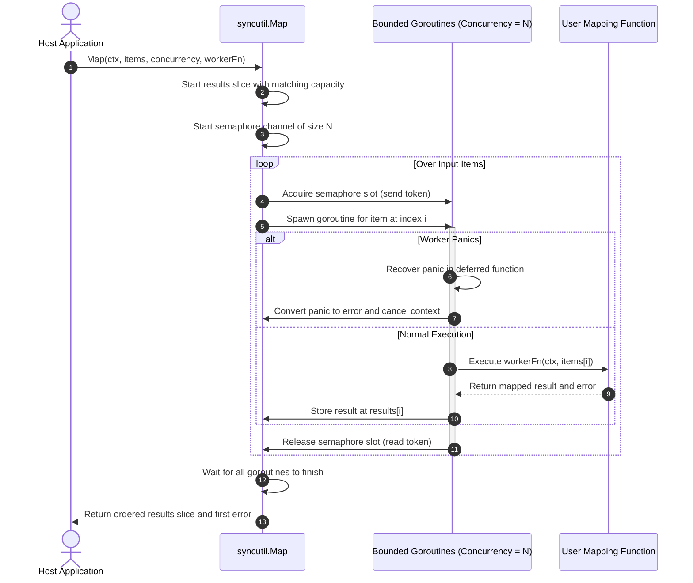

# SyncUtil Helper (`/syncutil`)

The syncutil package provides concurrency primitives for fine-grained locking and parallel slice processing with panic recovery.

## 1. KeyedMutex Architecture

The `KeyedMutex[K]` primitive serializes operations for matching keys while executing different keys concurrently in parallel.
It tracks lock usage with an internal reference counter and removes empty entries to prevent memory leaks.



### Procedural Steps (ASD-STE100)
1. Initialize the keyed mutex with `syncutil.NewKeyedMutex[K]()`.
2. Call `Lock(key)` to acquire a mutual exclusion lock for the specified key.
3. Defer the returned unlock function immediately after acquiring the lock.
4. Execute the critical section for that entity.
5. The unlock function decrements the reference counter and deletes unused map entries.

---

## 2. Bounded Parallel Slice Processing (`Map` & `ForEach`)

The functions `ForEach` and `Map` process slices in parallel using a bounded worker pool.
Both functions recover runtime panics and preserve item ordering.



### Procedural Steps (ASD-STE100)
1. Pass the context, items slice, concurrency limit, and mapping function to `syncutil.Map`.
2. The function allocates the results slice with the exact input length.
3. The function uses a channel semaphore to limit active goroutines.
4. A deferred recover function catches panics in each worker goroutine.
5. If a worker panics or errors, the function records the error and cancels the context.
6. The function stores each output at its original index to preserve ordering.
7. The function returns the ordered results slice to the caller.

---

## 3. Usage Examples

### 3.1 Per-Entity Locking (`KeyedMutex`)

```go
import "github.com/Jkenyut/nvx-go-helper/syncutil"

var userLocks = syncutil.NewKeyedMutex[string]()

func UpdateUserBalance(userID string, amount float64) error {
	// Acquire lock for this userID only
	// Other user operations proceed in parallel
	unlock := userLocks.Lock(userID)
	defer unlock()

	// Execute critical balance update
	return nil
}
```

### 3.2 Bounded Parallel Slice Processing (`ForEach`)

```go
items := []string{"task1", "task2", "task3", "task4"}

// Process tasks with a maximum of two concurrent workers
err := syncutil.ForEach(ctx, items, 2, func(ctx context.Context, item string) error {
	return processRemoteWebhook(ctx, item)
})
if err != nil {
	return err
}
```

### 3.3 Parallel Mapping with Order Preservation (`Map`)

```go
userIDs := []int{101, 102, 103, 104}

// Map user IDs in parallel with up to four goroutines
profiles, err := syncutil.Map(ctx, userIDs, 4, func(ctx context.Context, id int) (UserProfile, error) {
	return fetchProfileFromDatabase(ctx, id)
})
if err != nil {
	return err
}
// profiles[0] matches userIDs[0]
```
