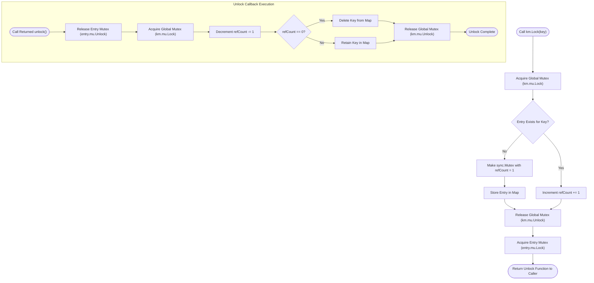

# SyncUtil Helper (`/syncutil`)

The syncutil package provides concurrency primitives for fine-grained per-key locking.
For concurrent worker pools and parallel task pipelines, see `/worker`.

## 1. KeyedMutex Architecture

The `KeyedMutex[K]` primitive serializes operations for matching keys while executing different keys concurrently in parallel.
It tracks lock usage with an internal reference counter and removes empty entries to prevent memory leaks.



### Procedural Steps (ASD-STE100)
1. Initialize the keyed mutex with `syncutil.NewKeyedMutex[K]()`.
2. Call `Lock(key)` to acquire a mutual exclusion lock for the specified key.
3. Defer the returned unlock function immediately after acquiring the lock.
4. Execute the critical section for that entity.
5. The unlock function decrements the reference counter and deletes unused map entries.

---

## 2. Usage Examples

### 2.1 Per-Entity Locking (`KeyedMutex`)

```go
import "github.com/Jkenyut/nvx-go-helper/syncutil"

var userLocks = syncutil.NewKeyedMutex[string]()

func UpdateUserBalance(userID string, amount float64) error {
	// Acquire lock for this userID only
	// Other user operations proceed in parallel
	unlock := userLocks.Lock(userID)
	defer unlock()

	// Execute critical balance update
	return nil
}
```
