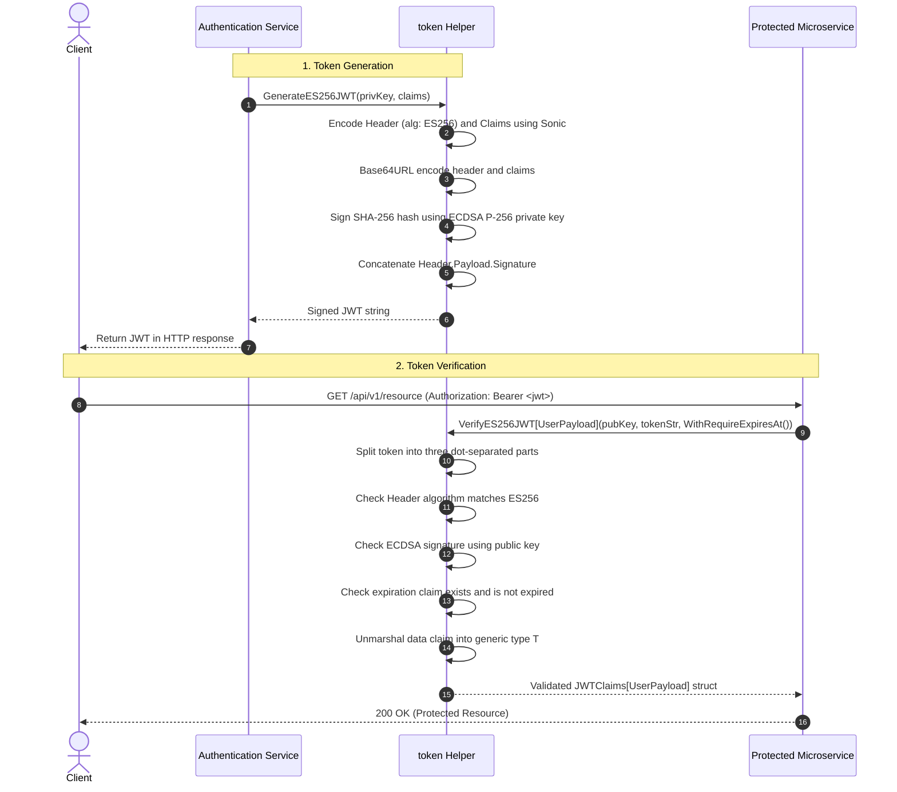

# Token Helper (`/token`)

The token package provides ECDSA (ES256) JSON Web Token (JWT) signing, verification, and claims extraction using `bytedance/sonic`.

## 1. JWT ES256 Lifecycle Sequence Diagram

The diagram below shows the token generation and verification process.



### Procedural Steps (ASD-STE100)
1. Call `token.GenerateES256JWT` with an ECDSA private key and claims.
2. The function serializes the header and claims into JSON.
3. The function signs the token hash using the ECDSA P-256 private key.
4. Pass incoming bearer tokens to `token.VerifyES256JWT` with the public key.
5. The helper checks that the header algorithm matches `ES256`.
6. The helper verifies the digital signature using the public key.
7. If `WithRequireExpiresAt()` is active, the helper confirms the token has an expiration timestamp.
8. The helper decodes the data claim into the target generic type.

---

## 2. Usage Examples

### 2.1 Generating a Typed JWT

```go
import (
	"crypto/ecdsa"
	"crypto/elliptic"
	"crypto/rand"
	"time"

	"github.com/Jkenyut/nvx-go-helper/token"
)

type UserPayload struct {
	UserID string   `json:"user_id"`
	Roles  []string `json:"roles"`
}

// Generate P-256 key pair
privKey, _ := ecdsa.GenerateKey(elliptic.P256(), rand.Reader)

claims := token.JWTClaims[UserPayload]{
	Subject:   "usr_101",
	ExpiresAt: time.Now().Add(24 * time.Hour).Unix(),
	IssuedAt:  time.Now().Unix(),
	Data: UserPayload{
		UserID: "usr_101",
		Roles:  []string{"admin"},
	},
}

tokenString, err := token.GenerateES256JWT(privKey, claims)
```

### 2.2 Verifying Tokens with Options

```go
pubKey := &privKey.PublicKey

validatedClaims, err := token.VerifyES256JWT[UserPayload](
	pubKey,
	tokenString,
	token.WithClockSkew(30*time.Second),      // Allows up to 30s clock drift
	token.WithExpectedIssuer("auth-service"),  // Checks 'iss' claim
	token.WithExpectedAudience("mobile-app"),  // Checks 'aud' claim
	token.WithRequireExpiresAt(),             // Rejects tokens missing 'exp' claim
)
if err != nil {
	// Handle ErrTokenExpired, ErrMissingExpiresAt, or ErrInvalidSignature
	return
}

user := validatedClaims.Data
// user.UserID == "usr_101"
```
