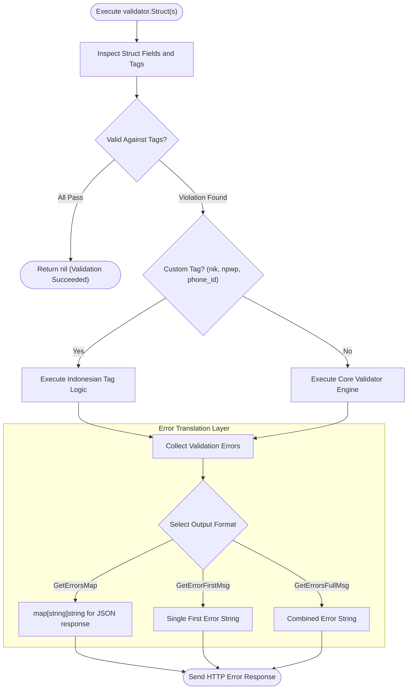

# Validator Helper (`/validator`)

The validator package wraps `go-playground/validator/v10` and provides custom validation tags for Indonesian identity numbers.

## 1. Validation and Error Translation Flow

The diagram below shows struct tag inspection and error message translation.



### Procedural Steps (ASD-STE100)
1. Add validation tags to the fields of your struct.
2. Call `validator.Struct` with a pointer to the struct.
3. If validation succeeds, the function returns `nil`.
4. If validation fails, call `validator.GetErrorsMap` to get a key-value error map.
5. Send the error map in your HTTP error response.

---

## 2. Usage Examples

### 2.1 Validating Structs with Indonesian Tags

```go
import "github.com/Jkenyut/nvx-go-helper/validator"

type CustomerProfile struct {
	FullName string `json:"full_name" validate:"required,min=3"`
	Email    string `json:"email" validate:"required,email"`
	NIK      string `json:"nik" validate:"required,nik"`
	NPWP     string `json:"npwp" validate:"omitempty,npwp"`
	Phone    string `json:"phone" validate:"required,phone_id"`
}

profile := CustomerProfile{
	FullName: "Budi",
	Email:    "budi@example.com",
	NIK:      "3201010101900001",
	Phone:    "081234567890",
}

if err := validator.Struct(profile); err != nil {
	// Format errors into a map for JSON response
	errMap := validator.GetErrorsMap(err)
	// Output: {"email": "invalid email address"}
}
```

### 2.2 Registering Custom Validation Rules

```go
v := validator.New()
_ = v.RegisterCustomValidation(
	"alphanumeric_space",
	customValidatorFn,
	"{0} must contain only letters, numbers, and spaces",
)
```
