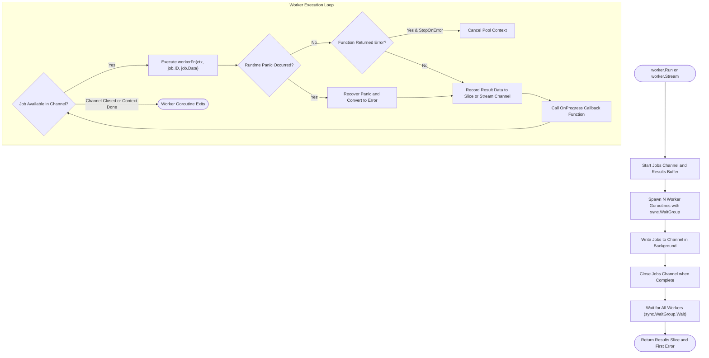

# Worker Pool (`/worker`)

The worker pool package executes generic jobs across parallel worker goroutines with context cancellation and progress tracking.

## 1. Worker Pool Lifecycle Diagram

The diagram below shows the worker pool execution flow.



### Procedural Steps (ASD-STE100)
1. Send the job slice and the worker function to `worker.Run` or `worker.Stream`.
2. Configure the worker count, timeout, and callbacks with functional options.
3. The pool starts the worker goroutines and the background feeder goroutine.
4. Each worker reads a job and executes the worker function.
5. A deferred recover function catches any runtime panic.
6. The worker records the result data or the returned error.
7. If an error occurs and `StopOnError` is active, the pool cancels the context.
8. The worker executes the progress callback function if configured.
9. The pool waits for all worker goroutines to finish.
10. The pool returns the results slice or closes the stream channel.

---

## 2. Usage Examples

### 2.1 Batch Execution (`worker.Run`)

```go
import (
	"context"
	"fmt"
	"time"

	"github.com/Jkenyut/nvx-go-helper/worker"
)

jobs := []worker.Job[string, int]{
	{ID: "job-1", Data: 10},
	{ID: "job-2", Data: 20},
}

workerFn := func(ctx context.Context, id string, data int) (string, error) {
	return fmt.Sprintf("result-%d", data), nil
}

// Execute worker pool with functional options
results, err := worker.Run(
	context.Background(),
	jobs,
	workerFn,
	worker.WithWorkers(4),
	worker.WithPreserveOrder(true),
	worker.WithWorkerTimeout(10*time.Second),
	worker.WithOnProgress(func(completed, total int) {
		fmt.Printf("Completed %d of %d\n", completed, total)
	}),
)
```

### 2.2 Stream Execution (`worker.Stream`)

```go
// Stream results as each job completes
outCh := worker.Stream(
	ctx,
	jobs,
	workerFn,
	worker.WithWorkers(4),
	worker.WithStopOnError(true),
	worker.WithOnProgress(func(completed, total int) {
		fmt.Printf("Progress: %d of %d\n", completed, total)
	}),
)

for res := range outCh {
	if res.Err != nil {
		fmt.Printf("Job %s failed: %v\n", res.ID, res.Err)
		continue
	}
	fmt.Printf("Job %s finished: %v\n", res.ID, res.Value)
}
```
